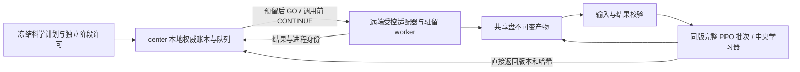

# 分布式训练、推理与评测：复用和维护手册

2026-10-30原生特征接线：模型适配、特征合同、公共采集与PPO／评测入口的职责和扩展步骤见本文末尾的原生模型特征接入章节。借用节点的只读健康监控接入center实时授权；CPU模拟不代替新特征路径的真实全轨迹与容量验收。

本页是分布式执行框架的稳定入口，维护模块职责、接入合同、故障恢复与扩展边界。
具体科学协议、授权、源码版本和容量证据属于各自运行目录；本页不签发运行许可。
2026-10-28补充：新域8回合适配通过独立schema进入现有collector/CPU learner，旧32回合协议不变。`controlled_campaign.campaign_nodes`在首次远端连接前只选择实际任务节点，显式排除节点直接拒绝、不自动迁移。Video维护停用记录由当前准备配置执行，不修改旧绑定或宣称操作系统级全局隔离。FastWAM和共同视觉桥仍需其独立真实数值/物理验收。

截至 2026-10-26，已运行的能力是受 center 账本与实时授权约束的三机评测、冻结操作模型的跨机 PPO 采样及中央 CPU 学习器。
后训练可以复用控制与记录机制，但新的模型训练后端仍需适配；不能把这些能力表述成已经具备通用 DDP/FSDP 训练服务。

## 可复用能力与边界

| 使用场景 | 已有实现可以复用 | 仍需适配或验证 |
| --- | --- | --- |
| 独立评测、批量推理 | 任务身份、动态槽位、预算预留、实时授权、跨块驻留、结果验收、显式恢复 | 每个模型的输入/解码/噪声、输出完整性、单卡容量和真实轨迹 |
| 当前 PPO 搜索训练 | 同策略版本完整回合收集、中央更新、直接通道发布确认、完整检查点、固定训练阶段导出 | 新环境/动作/奖励的科学合同；学习器发布仍有当前实验的批次与版本约束 |
| 独立后训练实验 | 不同条件的任务排队、资源预约、源码/数据身份、日志和恢复证据 | 训练命令、优化器/RNG/数据游标存档、完成判据、可恢复训练入口 |
| DDP/FSDP 或其他协同训练 | 所有权、整组资源与预算合同的设计原则 | 原子申请整个进程组、rendezvous/rank 生命周期、组级失败及检查点恢复；本轮没有实现或验收该适配器 |
| 模型批处理/持续推理服务 | 资源身份、驻留租约、按请求授权与独立记账 | batching 调度、逐样本 RNG 等价、取消/部分失败的调用归属；当前驻留不等于已实现通用批处理服务 |

当前原生模型的 48 worker（3 机 × 16，每 GPU 2）是该模型与已验收阶段的资源配置。
不能据此自动为其他权重、训练方式或任务开放相同并发。CPU 模拟槽位数量也不是 GPU 容量证明。

## 唯一实现和依赖方向

以下模块相对于 `AlphaBrain/research/dsol/`。核心不导入 `benchmarks`、`scripts`、`reports`，不硬编码机器路径。

| 职责 | 实现 | 维护合同 |
| --- | --- | --- |
| 科学身份 | `execution/manifest.py` | 任务/初态/视角/噪声身份不随主机或 worker 数变化 |
| 动态队列 | `execution/queue.py` | 任务状态、持久启动意图、所属进程、验收、显式恢复 |
| 所有权与预算 | `execution/controller_ledger.py`、`controlled_queue.py` | 在实际 start 前校验 owner/epoch/独立许可、去重并持久预留；保管记录不是许可 |
| CPU 授权传输 | `execution/authority_backend.py`、`authority_wire.py`、`authority_worker.py` | 用合成 worker 验证单点握手和故障；不承担真实模型执行 |
| 模型授权传输 | `execution/model_authority.py` | 远端 PREPARE/GO/ACK 与调用前 CHECK/CONTINUE；同轮检查合并，不缓存未来健康或额度 |
| 入口限制 | `execution/dispatch_policy.py` | 注册的受控队列与持有实时授权的限定模型作用域；旧直接入口不能使用旧许可解锁 |
| GPU 与驻留 | `execution/gpu_guard.py`、`worker_gpu.py`、`resident_session.py`、`resident_runtime.py` | 进程出生身份、加载峰值、租约与失效；驻留每块仍重新预留/授权 |
| 学习器交接 | `execution/learner_publication.py` | 更新前唯一持久意图；直接返回的版本/哈希确认；未知更新不重做 |
| 阶段接续 | `execution/staged_evaluation.py` | CPU合同→首块真实门槛→剩余阶段→报告；每阶段启动前持久意图，失败保留、不自动重放 |
| 训练与导出 | `selectors/continuous_ppo.py`、`continuous_parallel.py`、`continuous_export.py`；`data/continuous_training_store.py`、`training_stage.py` | 同版完整批次；模型/优化器/RNG/游标检查点；明确阶段修订与导出，不冒充原长计划完成 |
| 计时与分析 | `execution/phase_timing.py`、`analysis/`、`reports/paper1/` | 原始事件与科学统计分开；结果展示不承担派发或自动重试 |

外层 `benchmarks/LIBERO/continuous_authority*.py`、`controlled_training.py`、`controlled_learner.py`、`controlled_recovery.py` 负责模型、仿真、数据解码和真实结果合同。
`recovery_preparation.py` 负责恢复清单构造，使用已绑定模型声明的预期哈希补全依赖，并调用真实恢复校验器；不得用当前文件哈希直接“认可”未经绑定的模型。
`simulator_session.py` 与模型 runtime 的生命周期也属于适配层。换 benchmark 时实现其适配器，不把第二套控制器拷入 benchmark。



NFS 上的可变 `current.json`、RUNNING 文件和锁不是跨机启动授权来源。
共享文件可能暂时旧读；锁互斥正常也不能证明各客户端此刻看见相同内容。
center 本地账本是唯一权威，远端必须持有绑定 owner/epoch、会话和任务的实时授权。
不可变产物用内容哈希验证；暂时读不到正确版本时等待有明确上限，超限停止，不能再执行一次优化器来“修复”可见性。

## 新任务和后端怎样接入

1. **先定义工作单元和科学清单。** 独立轨迹、同版 PPO 回合批次、DDP 进程组有不同完成条件。任务 key、输入/源码哈希、划分、噪声、上限先冻结；资源槽单独配置。
2. **实现既有 Backend 合同。** `admit(slot)`、`start(task, slot, attempt)`、`locate(...)`、`poll(handle)`、`alive(handle)`、`cancel(handle)`、`validate(task)`。所属 handle 必须可验证进程出生身份；“没有找到输出”不等于“没有启动”。取消仅用于确证属于本次尝试的进程。
3. **接入账本与实时授权。** 不能只包装 CLI。实际启动边界必须经过 `LedgerBackend` 和注册控制作用域；真实模型必须接入实时调用授权。新适配器需要显式注册、测试，不能靠一个任意动态后端参数绕过。
4. **定义验收与计费。** 输出包含科学地址、来源哈希、完整性、查询/调用实耗及失败证据；失败轨迹也保留。任务成功率不是工程完成判据。未知消耗保留预留，不能自动退款。
5. **做实际入口的 CPU 故障测试。** 覆盖重复 controller、旧 epoch、预留后崩溃、start 后 ACK 丢失、部分块失败、断联、显式恢复、结果冲突；不能只测账本内部函数。
6. **单独准入真实后端。** 输入/首帧、模型数值、返回轨迹、冷/热驻留与容量分别有证据；扩大并发不改科学地址。新数值路径或新模型的 CPU 通过不替代 GPU 准入。
7. **冻结发布再运行。** 保存 source manifest、解释器/依赖/资产身份、运行绑定、许可和容量记录。CLI 只组合模块；参数配置不得形成第二套算法。

当前入口区分：`scripts/dsol_paper1/operations/manage_controlled_queue.py` 是 CPU 模拟入口；
`manage_model_queue.py` 组合已注册的 LIBERO 模型适配器；`manage_work_queue.py` 的历史动态执行入口已经关闭。
这不是“传一个后端名即可运行任意训练”的通用 CLI。历史冻结副本及同权限任意 Python 代码不受操作系统级隔离；禁止手工旁路启动，新增入口须审计。

## 恢复与持续训练

| 故障 | 必须保留的证据 | 恢复边界 |
| --- | --- | --- |
| 预留后尚未确认启动 | 预留、attempt、远端意图与进程定位 | 先核对是否实际启动；不能仅看队列状态重新派发 |
| 已启动但 ACK/连接丢失 | 会话、调用序号、启动身份、预算 | 按未知消耗处理；停止新增授权，不自动重连重发 |
| 部分块失败 | 所有子任务地址、完成输出和失败记录 | 完成项验收后复用；其余显式核对，不整批盲重跑 |
| 学习器结果未知 | 唯一更新意图、直接通道日志、不可变版本检查点 | 查明更新是否落盘；同版优化器不可再次自动执行 |
| 主机/controller 重启 | 旧 epoch、boot ID、start ticks、许可和预留 | 旧 PID/期限不作新身份；显式恢复后另建绑定，无自动主节点接管 |
| 训练阶段导出不完整 | 完整 checkpoint、actor、优化器/RNG、阶段哈希 | 未 pin 完整检查点不能宣告阶段结束或启动后续评测 |

这里提供的是防重复启动与可审计恢复，不保证在任意网络/进程崩溃下自动完成“恰好一次”执行。
账本的 `reserved` 上限在 COMPLETE 后可继续保留作审计，不能把该字段非零直接解释为未结算；须结合任务终态、实耗和未知项。

继续训练必须使用完整检查点和下一数据游标，不只加载 actor 权重；训练量、训练集或模型条件变化另立协议修订。
当前 2,048 回合阶段保留原 8,192 回合配置/日程身份，pin 阶段末完整检查点，以便获准后从后续回合接续。
已观察的评测集不能悄悄变成下一轮调参集后仍声称独立验证。

## 加速怎样保留科学等价性

按“等待/启动、权重加载、输入与哈希、渲染、模型调用、写盘、学习器更新”计时；同时记录端到端 wall time、有效吞吐、长尾、失败与调用数。
不能只看 GPU 利用率、worker 数或单函数耗时宣称整轮倍速。

已采用的工程模式：

- 同一许可和资源身份内跨块驻留，逐块记账/验收；失败使会话失效。
- 同轮授权检查共享一次新鲜核验，逐 worker 发对应序号响应，不预发未来额度。
- controller 全局输入预检、worker 校验自身消费的基线依赖；按路径/内容哈希去重，冲突即拒绝。不能用 NFS mtime 或旧成功记录跳过内容核验。
- 在任务顺序、首块门槛和预算不变时扩大 wave，减少重复编排；阶段期限须覆盖新 wave，但旧期限不可复用。
- CPU 提前构建可校验的基线引用，训练完成后核对六组导出再接恢复评测。

2026-10-26 恢复队列已准备 288 块 wave、44→23 个 wave，CPU 模拟入口完成 288 块验证。
这是当前恢复阶段的发布证据，不保证其他训练可随意扩大批次：PPO batch size 会改变优化过程。
模型速度捕获的 `deferred_cpu` 候选仅完成 CPU 等价验证，未纳入当前生产 release；不计入已实现的 GPU 提速。
批处理、CUDA graphs、精度变化、跨 PPO 更新的模型持续驻留均不能在没有各自准入证据时声称已上线。

## 测试和发布维护

从仓库根目录，在配置好的 CPU Python 下运行（不启动正式实验）：

```bash
python tools/repository/check.py
python tools/paper1/check_architecture.py
python tools/paper1/check_layout.py
python tools/paper1/project.py check
python tools/repository/test.py --profile portable
```

| 合同 | 主要测试（`tests/dsol_paper1/` 下） |
| --- | --- |
| 预算/所有权/真实 start 边界 | `execution/test_controller_ledger.py`、`test_controlled_queue.py`、`test_work_queue.py` |
| 模型授权/驻留/资源身份 | `execution/test_model_authority.py`、`test_resident_authority.py`、`test_worker_gpu.py` |
| 学习器发布/阶段恢复 | `execution/test_learner_publication.py`、`data/test_training_stage.py` |
| 恢复依赖和任务组合 | `runtime/test_recovery_validation.py`、`data/test_native_recovery.py` |
| 真实准备器与校验器组合、阶段首块门槛与未知启动 | `runtime/test_recovery_validation.py`、`execution/test_staged_evaluation.py`；替换模型/仿真可以，不能同时把受测接口两边都替换为成功桩 |
| 实验实际启动入口 | `execution/test_fixed_stage_launcher.py`、`test_prepared_recovery_launcher.py` |
| 大 wave 的队列与授权组合 | `execution/test_recovery_wave_capacity.py` |

最后两类中依赖持久实验 preparation 路径或较长 CPU 演练的测试是显式 opt-in，默认跳过不是验证通过。
实际 launcher 测试的路径由各测试要求的环境变量显式指定；288 块测试使用 `DSOL_LARGE_CPU_QUEUE=1`，是 6 个 CPU 模拟槽，不能写成 48 个 GPU worker 验收。
历次测试数量属于各自源码快照，不能用旧计数为新修改背书。

## 仍需收回框架的专用编排

当前活跃实验的 preparation 脚本是冻结组合层，维护期间不热改。它们不是以后复制新实验的模板。

| 技术债/兼容范围 | 下一次安全维护的目标 | 完成条件 |
| --- | --- | --- |
| run 内训练/恢复 pipeline 和 stage contract | 将阶段依赖、等待/导出/准入/派发状态机抽回执行层，实验只传配置和适配器 | 对旧 launcher 的状态转换与故障语义对照；测试跑包内实现；新 release 独立准入后不再新增专用副本 |
| `learner_publication` 固定 32 回合/更新、上限 256、CPU 优化器与冻结操作模型 | 将协议约束做成显式验证合同，保持现有合同默认严格 | 混版/错误批次/未知更新测试保留；不同学习器独立验收，不放松现有检查来求通用 |
| `training_stage` 与 native recovery 面板 | 保留科学数据结构归属；只抽通用生命周期 | 新模型不依赖 native 专用面板；旧清单/结果/预算字节不变 |
| 老 `CollectorBackend` 复用 RoboCasa `ProbeBackend` | 提取共同进程生命周期，benchmark 保留命令和验收 | 两方启动间隙、进程身份及失败清理等价；不热换历史 release |
| DDP/FSDP 与通用 batching | 实现独立后端合同，而不是伪装成独立评测任务 | 组级/请求级资源与故障测试、真实容量和数值验收均通过 |

退出兼容例外前必须登记调用者、活跃进程、前后源码哈希、恢复路径和验收记录。
框架维护不能改旧实验的执行字节；新实验先复用包内 API，确需临时组合时登记目的、范围和退出条件。

### 批推理与协同后训练的统一接入顺序

仓库 `AlphaBrain/training/train_alphabrain.py` 已有 Accelerate 的普通 DDP 与 DeepSpeed 分支；
“尚未接通”指这些训练模式尚未接入本页的 center 受控生产链，不表示仓库从来没有分布式训练实现。
扩展优先复用已有训练器；FSDP 的配置、检查点分片和运行准入须单列，不能从 DDP 支持推断。

1. **共用控制层。** 沿用 manifest、owner/epoch、预留、实时授权、阶段意图和完整性回执。新增后端仍经过注册与实际 start 边界测试；不另建运维服务。
2. **批推理保留请求粒度。** 每个请求保留科学地址、显式噪声、预算与结果身份，批次只影响执行组合。请求局部失败不能重发整个批次；未确认的消费留在未知项。数值/随机数等价与端到端吞吐通过后才替换原推理路径。
3. **DDP/FSDP 保留进程组粒度。** 一个工作单元申请整个 GPU 集合，每个 rank 绑定组ID、owner/epoch、world size和出生身份；全部资源就绪才启动。rank失联按组停止新增工作，恢复必须使用配套优化器/RNG/采样游标及所有分片。不能用评测的每卡双worker规则启动协同训练。
4. **验收分层。** 先做真实入口的 CPU 故障合同与 CPU collective 小模型验证，再做限定 GPU 容量/检查点等价，最后绑定具体科学训练预算。当前评测接续独立于这些新增能力。

2026-10-26 首次恢复接续曾因模型文件未列入清单而在派发前停止。修复新增实际准备器与实际校验器的组合回归，以及共用阶段接续模块；原始失败清单和日志保留。后续接入不得只用“每个模块单测通过”替代完整启动链验证。批推理和协同训练的生产适配仍是未完成项，不能因为写了统一合同就宣称已经上线。

## 落盘与证据位置

仓库只保存代码、测试、稳定文档和非敏感配置。持久项目根的 `runs/<run-id>/` 保存冻结协议、源码快照、环境清单、许可/预算审计、不可变输出、检查点与回执。
center 本地 `.runtime/queues/<run-id>/<host>` 保存运行权威状态；共享盘快照供恢复核对，不自动变成新的权威。丢失本地权威时停止派发并显式恢复。
凭据与基础服务恢复由既有管理流程负责，不复制到 share/Git，不另建代理、SSH、保活或重复监控。

本次整理回执：持久项目 `runs/distributed-framework-consolidation-20261026/`。
历史工程依据见 [恢复评测优化](../dsol_paper1/history/recovery_evaluation_optimization_20261026_zh.md)、
[固定训练阶段](../dsol_paper1/history/native_fixed_training_stage_20261026_zh.md)、
[推理候选优化](../dsol_paper1/history/native_inference_engineering_20261026_zh.md)。
科学与启动标准继续见 [执行管理协议](../dsol_paper1/protocols/execution_management_zh.md)；本页作为其当前能力与维护索引，不覆盖历史回执。

## 原生模型特征接入与搜索训练接口

目标是复用同一搜索算法和执行框架。操作模型保持冻结，各自提供真实原生表示；搜索权重能否跨表示迁移仍需实验，接口兼容不是效果证据。

### 四层职责

| 层 | 输入与输出 | 实现归属 |
| --- | --- | --- |
| 模型适配 | 传感输入、冻结噪声 → 动作轨迹、Accel、原生特征 | `AlphaBrain/model`捕获原语；`benchmarks/LIBERO/model_adapters.py`注册运行时 |
| 特征合同 | 明确的token网格、相机角色 → 池化特征包及来源身份 | `data/native_observation.py`、`data/native_features.py` |
| 搜索采集 | 特征、位姿、历史 → 连续运动／STOP、完整回合 | `acquisition/native_search.py`与benchmark的`native_view_source.py` |
| PPO与执行 | 完整批次 → G结算、更新、版本发布、独立操作评测 | 共享`continuous_ppo.py`及受控采集／学习器／评测入口 |

核心不导入benchmark或机器配置。模型注册表延迟导入运行时，不允许配置指定任意Python类。

### 表示合同

每流声明名称、通道数、真实相机身份、movable／context角色，以及per-view／joint语义。联合编码不伪装成独立相机。确实缺失的上下文使用mask；至少获取一个真实可动相机流。不复制头图充当腕图，也不截断维度凑旧接口。

显式THW网格经2×2空间池化得到每流4C维表示，逐流归一化和投影后进入共享历史网络。查询包带query ID及输入／历史／模型／生产器SHA256。捕获层、token形状、布局和池化配置进入生产器及策略合同，相同维度不代表语义相同。每suite另固定完整运行时合同和权重。发布与采集记录绑定训练协议SHA256，防止预处理或源码协议变化后误用旧版本。

FastWAM读取同次原生forward的首帧视频prepare tokens，保留联合表示；GR00T读取实际每视图视觉提取输出，在eager调用边界捕获CUDA graph返回值。不额外调用模型、不读取未来生成帧，不用源π0.5视觉塔冒充目标表示。真实形状与完整轨迹一致性须经实际模型验收冻结。

### 采集、更新和恢复

新schema选择原生路径，共用原有运动、查询计费、返回重查、在线G和PPO。保持prefix3、查询上限8、λ=0.01及已批准划分，不切换P9或改奖励。完整32回合后结算更新；suite专用模型分块路由，块内不混检查点。

特征包、rollout与发布分别核对来源、协议和版本。错误前已尝试调用保留计费。使用标准队列、controller ledger、逐块预算预留及center实时授权。断联、陈旧健康或未知消耗不自动退款、重放或换机。历史冻结入口仍有其兼容边界，本接口不是系统层全局隔离。

原生多 suite 清单通过 `controlled_campaign.resident_runtime_slots` 按完整仿真／模型合同内容划分驻留槽位。同内容的不同路径可共享池；不同合同在同一 campaign 内不能共享槽位。每台主机按其既定任务分配槽位，不迁移任务；下一个 campaign 在旧 worker 退出后重新分配。底层驻留缓存仍严格拒绝身份变化，不以热换权重或扩大显存缓存掩盖错误。训练按全部 64 次更新、评测按全部冻结 wave 检查槽位不交叉。

中断采集只能在核实原 worker 已退出后显式恢复。`NATIVE_COLLECTION_RECOVERY_V1` 绑定旧清单、同一 actor／版本、协议、进程审计和完整回合文件哈希；在学习器上重新验证概率、价值、动作及原始奖励记录。复用全部通过核验的完整回合，不按奖励或成功筛选；未完整保存的回合不算已完成。未知预算继续保留，后续每批预留时计入既有已结算消耗与未知上限。不得把恢复证明作为自动重试许可。

CPU 故障／合同／全清单编译验证与真实派发前校验分开：无需对每一更新或评测 wave 重跑同一整套远端 CPU 模拟，但每次真实 `run_stage` 仍核验不可变输入、actor、节点、预算、所有权和 epoch。减少重复模拟不能取消失败关闭、NFS 实时授权或真实模型准入。

### 扩展新模型与相机布局

1. 登记运行时：固定动作、真实采样trace、原生特征读取、预热成本与操作replan合同。
2. 声明真实相机、捕获层、网格和历史刷新规则；不由张量长度猜相机或时序。
3. CPU模拟覆盖完整采集、PPO更新、版本交接、失败记账及恢复，继续复用公共算法。
4. 受控准入比较原始动作、仅评分、评分加特征三路：固定噪声／RNG，核对动作、trace、score、RNG、视角变化及返回刷新；再比较完整操作轨迹。所有调用从工程预算扣除。
5. 测量显存与吞吐，确认新绑定后按科学清单派发。

当前LIBERO适配器使用真实外部／腕部输入。核心覆盖单流、双流与三流CPU模拟；GR1、真机仍需自身同步、标定、头部控制和操作适配，不能据此声称已经通用接入。

### 借用节点监控

`execution/node_health.py`与薄入口`operations/watch_research_node.py`复用GPU身份检查，只观测SSH、共享盘、boot、GPU UUID和可信保活进程。center本地状态接入实时授权；NFS镜像只作证据。失败锁存HOLD，需显式审计恢复，不自动重启保活或重发任务。

此监控不替代基础运维、不保证平台不会释放实例。center停止时不能承诺主动聊天通知，健康过期会拒绝新授权。借用节点的程序、日志和解释器留在项目专属目录，不修改机主系统环境。

### 验收边界

CPU模拟证明软件路径、合同及记账。真实模型动作／全轨迹一致性及容量验收通过之前，新原生特征训练不标记为已开始。日期证据入口见项目首页，保存源码快照、失败日志和恢复步骤。

2026-10-30已完成Fresh上的原生链路工程验收：FastWAM四suite、GR00T四suite及同卡双worker，共9条完整操作轨迹、215组三路数组。FastWAM实测分配峰值约23.3 GiB，使用每卡1 worker；GR00T约8.8 GiB，同卡两进程同时驻留实测设备占用峰值约21.6 GiB，使用每卡2 worker。保留更保守的加载峰值预留和保活余量，不按分配峰值压缩资源限制。此结论绑定此次源码、运行时、输入及Fresh设备；新节点仍须核对解释器、GPU身份和运行绑定，不继承旧PID／许可。容量通过不是训练收敛或跨模型迁移有效的证据。

### 发布来源与验收复用

2026-10-30 运行故障补充：GPU 两次采样间的成员变化是瞬态观测不一致，
不能直接标为保活身份失效。`gpu_guard.preflight`可在显式绑定中设置最多三次
新鲜采样；身份错误、未知占用、显存不足仍拒绝。重采样发生在启动前，不是任务
重试。中断后必须核对旧进程组、保留不明预算、校验完整同版本回合，再以新控制目录
从原检查点恢复，不能仅重新执行旧命令。错误信息现在保留具体采样原因。

验收传输新增可选`persistent_inspection`，默认关闭，当前为CPU验证候选。
它为每台节点保留一条专用只读连接，逐任务重新检查解释器／源码、任务锁和结果；
不缓存验收结果，不接受`PREPARE`或任何执行指令。连接空闲时用只读心跳维持，
断联、会话／任务身份不符或仍持锁立即拒绝；同一后端实例禁止重连兜底。
`test_persistent_inspection.py`在真实CPU入口覆盖复用、回执篡改、身份错误、
锁冲突、断联和协议越权，已加入portable测试。开关默认关闭，冻结版本不热切换。
2026-10-30四节点独立真实轨迹验收后，在完整PPO批次边界建立r7生产绑定。
验收源、控制器源与旧数学计算源分别记录；CPU连接性能不等于整体训练提速。

完整批次暂停使用 `execution/batch_boundary.py` 的 `pause_requested`：仅在
当前批次所有回合结算、三个优化器更新并发布检查点后，检查center本地
`operator-pause.json`。请求必须绑定当前experiment_id、配置SHA256和
非负整数after_version，schema为`PAUSE_AT_COMPLETE_BATCH_V1`；不匹配即拒绝。
达到指定版本时写PAUSED_AT_COMPLETE_BATCH并退出，不派发下一批、不接评测。
请求本身不授予执行权限，删除请求也不自动续跑；恢复仍须审计并建立新绑定。
控制器冻结副本与复用模块校验同字节，暂停测试覆盖缺请求、提前请求、已到边界、
错运行、错配置及非法版本。旧入口缺少此钩子时，本次通过下一阶段launcher目录
停止屏障阻止远端准备，并证明该阶段没有账本、绑定或GO，保留原始停止证据。

启动并行化需另做所有权事务设计：当前启动握手持有账本锁，不能直接在其中调用
需要同一锁的`poll_many`，也不能用线程池并发共享Wire。应先将持久启动意图与
远端准备拆开，再于GO前重新验证所有权、epoch、期限、预算和同GPU锁；故障测试
覆盖准备成功而ACK丢失、并发取消、部分块失败后，才进入生产。该部分尚未实现。

训练清单的运行时校验按一次调用去重：同一合同只验证一次；后续调用仍重新读文件，不保留跨进程或跨 NFS 校验缓存。块级路由继续核对 suite、权重、actor 与协议身份。仅修改校验路径时另立源码快照，逐文件证明模型／特征／PPO／仿真计算代码字节不变，并保留旧 GPU 证据的原始源码身份；不得替旧证据换标签。相关回归覆盖重复合同、冲突身份及下一次调用文件改变后的拒绝。

完整启动检查还须用目标节点解释器构造原生搜索观测空间。模型轨迹验收不会覆盖 Gymnasium 等搜索侧依赖，不能以模型能运行推断训练环境完整。依赖恢复仅进入项目独立解释器，记录共享包文件哈希，禁止覆盖系统 Python／Torch。

原生actor发布物必须包含模型族、四个suite的权重与完整运行时合同哈希、特征生产器与布局、训练协议、初始化文件哈希和具体运行种子。加载端从冻结协议构造完整预期身份，拒绝缺失上下文及同形状不同来源的发布物，再应用权重。不能依赖给Python对象附加可选属性来开启校验。合法迁移需要显式的新目标初始化合同；复制来源标签不构成迁移证据，也不是防恶意伪造的签名机制。

真实验收比较原始／仅trace／原生特征三路的动作、trace、score，以及Torch CPU/CUDA、Python、NumPy默认随机状态；同时检查特征生产器、输入、历史、视角变化及返回。自定义随机生成器和模型内部缓存仍须由具体适配器纳入其合同与测试，默认RNG检查不是所有内部状态的证明。

工程验收也可能执行完整操作轨迹，不能把`admission`一概当作零执行调用。通用执行入口必须分别结算评分与操作调用，并与逐调用尝试、成功日志核对。2026-10-30新增实际授权入口回归，覆盖评分19次、操作24次必须共计43次；旧的纯评分验收仍为零操作调用。已经生成的错误汇总保留，另附补账证据，不覆盖原始记录。

调用前还必须验证工程噪声库覆盖每个声明的训练初态及最大重规划索引；哈希正确不代表地址覆盖正确，测试集噪声库也不能代替训练初态噪声库。缺地址、长度不足、形状错误和未绑定张量均在CPU侧拒绝。工程专用噪声可独立冻结，不修改科学实验噪声或用工程样例计算主结果。容量验收使用独立任务地址及各自预算，同卡并发必须有两个进程同时驻留的实测证据；不同模型不继承相同worker数。证据目录为持久项目`runs/native-feature-gpu-admission-20261030/`。

验收只用训练初态。训练与评测可以复用同一已验收运行时，但只允许人口清单`inputs`和初始噪声`anchors`路径不同：其余模拟器字段仍全部参与运行时摘要。原验收配置及其哈希必须保留并加入目标清单；新数据、噪声、划分也必须分别绑定和验证。不能为了配置文件哈希一致而把评测初态混进训练准入。

### 独立随机获取对照

`acquisition/random_acquisition.py`只接收当前合法运动增量边界，以私有种子均匀采样连续增量；它不读取分数、视觉或Local/PPO候选。共用连续搜索引擎负责查询、预算、最低已访问Accel选择与必要返回重查。其分布是合法增量上的随机游走，不是全角度域或球面上的均匀分布。

π0.5新增`INDEPENDENT_RANDOM_RECOVERY_V1`走既有受控评测入口，禁止加载actor，保留相同初态／起点／评分噪声／执行噪声。独立性针对获取规则，不取消实验配对。最多8查询且不学习STOP；与G只能称相同查询上限，不能声称实际花费相同。必须同时报告成功率、净救回、损害、实际查询及耗时；证明STOP价值需另做匹配训练的消融。

旧`random_from_local`仍是同候选集合内的随机选位，旧冻结结果不改名覆盖。新增评测使用独立清单、地址、预算与运行绑定，不借用历史剩余许可。当前CPU证据及提案：持久项目`runs/pretraining-audit-followup-20261030/`。

### 2026-10-31：有界并行准备与单线程最终授权

`ModelAuthorityBackend` 增加显式 `parallel_launches`（1..32，默认1）。大于1时，标准队列把任务保留为 `LAUNCHING`，先持久化预算与唯一意图，再并行建立独占的 SSH 连接；主线程以非阻塞帧读取推进 PREPARE/READY/GO/ACK。线程池仅能建连与验证 HELLO，不接触账本、共享 peer Wire、PREPARE、GO 或 CONTINUE。已有 worker 的 CHECK 不再被另一个 worker 的 READY/ACK 等待占住。

所有权、epoch、精确许可、任务/槽位/尝试身份、预留预算与新鲜节点连通性仍在 GO 前校验；保存 GRANTED 并完成持久检查点后重新检查许可，再发送 GO。资源 drain 在该事务中再次核对。不同 GPU 可以并行准备，同一物理 GPU 同时只允许一个准备握手，以保留远端非阻塞 GPU 所有权锁；已授权 sibling 可按冻结容量共同计算。并行准备数量不等于模型批推理，也不改变每卡 worker 上限。

连接超时、错误身份、丢 ACK、部分完成或断联均停止派发；取消仅关闭已拥有的传输，迟到的建连线程只能关闭连接。预留不自动退还、任务不自动重放。显式恢复用新的控制器传输重新审计，不能把旧的已污染 resident 通道重新标为健康。`receive_ready` 保留未完整 JSON 帧并立即返回，避免半包阻塞其他 worker。

核心实现为 `execution/parallel_launch.py`，通过 `controlled_queue.py` 与唯一标准 `queue.py` 接入，LIBERO 只负责传递配置。`execution/test_parallel_launch.py` 的实际 CPU 入口覆盖并发、同 GPU 序列化、慢准备时继续计算、双控制器、许可/epoch失效、持久化后过期、账本丢失、drain、断联、丢 ACK、部分结果、显式恢复及迟到连接。CPU证据与真实 GPU 验收分开保存；工程与生产切换回执见 `runs/two-model-mainline-launch-20261030/parallel-start-20261031/`，不得仅凭此接口说明宣称生产已上线或给出加速倍数。

完成通知必须在内存中保持到回执验证结束，不能把一次性 DONE 当作仅本轮有效的事件；否则分批验收时会漏掉已完成任务。等待验收的 resident 继续接收仅保持连接的 IDLE_PROBE，不领取计算许可。完成突发专项测试同时覆盖持续 DONE 状态、回执间轮询和等待期间心跳。最终候选已通过18项并行专项、910项portable（78项环境跳过）；真实远端CPU合同另外验证四节点各自角色，仍不把CPU模拟账本中的计数当成真实模型调用。

### 运行期间的离线优化准备

`execution.phase_timing.summarize_completed_stages(receipts)` 是纯 CPU 回执统计接口。
调用方按模型、源码版本和科学协议分组，仅传入 COMPLETE、非 CPU 模拟且派发已关闭的阶段回执；
函数拒绝重复阶段、无效耗时与不完整结果，按总工作量除以总阶段耗时计算吞吐。
缺失的计时项单独报告覆盖数，不补成零。它不读取账本、不发运行许可，也不估算整个训练或评测的剩余时间。

```python
from AlphaBrain.research.dsol.execution.phase_timing import summarize_completed_stages

summary = summarize_completed_stages(completed_stage_receipts)
# 不同模型、release、CPU模拟与真实执行必须分别汇总。
```

回执检查耗时可能与 worker 计算重叠，各计时器也可能重叠；不能相加后从总耗时扣除，
不能把计时占比直接宣称为可实现的加速比例。跨阶段准备和学习器更新不在这些阶段耗时内。
测试入口为 `tests/dsol_paper1/execution/test_phase_timing.py`，纳入 portable profile。

优化接入顺序与验收条件：

| 候选工作 | 当前准备方式 | 启用前要求 |
| --- | --- | --- |
| 源码验证与回执 IO | 用已完成阶段统计确认频率和累计成本；设计按内容身份存放的本地只读源码副本 | 首次逐文件哈希，原子发布；不能仅凭路径、mtime或NFS锁复用；实时授权、每任务结果哈希仍须保留；损坏/替换/断联故障测试与真实轨迹验收 |
| 跨 PPO 批次驻留模型 | 复用现有 resident 生命周期接口，先设计策略版本切换测试 | 完整批次屏障、优化器/RNG连续、清空任务/相机/模型时序缓存；与冷启动逐轨迹比较；旧版本请求必须拒绝 |
| 通用批推理 | 离线设计请求身份、显式噪声、预算预留与逐请求结果合同 | 不改变科学噪声和去噪网格；单项失败不重放整批；真实数值、容量与端到端吞吐验收 |
| DDP/FSDP | 复用已有训练器，规划整组资源和检查点合同 | rank/组身份与进程组故障测试，全部检查点分片和优化器/RNG恢复验收；不是当前搜索 PPO 的前置条件 |

以上候选不能因文档或离线检查通过而视为已接入。当前冻结训练与评测接续继续使用已准入版本；
新的候选先独立验证，在后续完整阶段边界另建运行绑定。不得靠放松来源、预算或结果校验换吞吐。

### 2026-10-31：本地源码副本、有限恢复和待派发工作量分配

`source_release.materialize_verified_release(snapshot, destination)` 只在显式准备时运行，
逐文件核对输入和复制后的 SHA256，在本地文件系统写入临时目录后排他发布，拒绝路径越界、
符号链接、重复条目和覆盖已发布目录。返回的新 manifest 只改源码路径，保留代码内容身份。
每次远端请求仍执行原有源码、解释器、任务结果检查；不使用 mtime 或缓存的 PASS 替代这些检查。
本地副本可在节点重建时丢失，恢复时必须从共享冻结源重新准备，不能静默回退并假定已准入。

本次 FastWAM 将同字节 R8 的1,424个源码文件放入本地副本，生产执行配置为 r11。
当前单 release 绑定要求 center 和执行节点使用同一个绝对源码路径；cy 上复用其已有研究目录，
其他节点建立同路径的源码专用目录。这是路径布局约束，不能从目录名推断主机身份。
后续若支持每节点不同路径，应扩展绑定合同并测试，不能临时替换环境变量。
Fresh 新增39次模型调用完成完整数值/轨迹验收；cy 继承已准入 R8 的原生数值证据，
以逐文件同字节核对、当前完整训练批次与两节点新路径CPU合同补充来源链，不声称 cy 新跑了 GPU 数值验收。

`node_health.trusted_keeper_snapshot` 对明确的 `TransientMonitorError` 最多重新采样3次；
来源/身份错误不重试，SSH断联不自动清除 HOLD。此功能只读核验保活，不控制保活进程。
`attempt_supervisor.RecoverySupervisor` 对明确故障身份先落盘 AUDITING，再保存审计证据与
LAUNCH_INTENT，最后调用适配器。未知启动、重复控制器、超过次数或期限一律拒绝重复恢复。
原始消费、未知预留和总预算由适配器核对；监督器本身不授权模型调用。

当前生产恢复适配器仅覆盖 FastWAM **所有旧进程已停止、没有模型调用记录、没有完整回合产物**
的空采集故障。须核对原主机代次、输入、最后完整检查点与预算；新绑定继续保留未知预留，
最多自动恢复2次。有部分回合、模型调用、学习器阶段故障、GR00T评测失败或审计不通过时保持 HOLD。
这是有限恢复，不是任意训练/评测的自动重放服务。当前研究监督器每30秒检查，在共享目录记录状态变化；
本环境没有可用的桌面自动通知通道，落盘事件不等于用户已收到通知。

`balance.assign_pending_blocks(blocks, capacity, cost=...)` 在创建队列前按预定工作量从大到小分配，
使用已准入容量权重，保持每条科学任务内容、噪声地址和预算不变，拒绝带运行句柄或尝试状态的工作。
FastWAM尚未派发的评测组合已接入并逐行核对；当前等容量两节点的总工作量原本已平衡，
不能宣称该分配器带来了已测得的加速。它用于减少长尾并支持后续不同容量的配置。
GR00T在途评测保持原绑定；跨模型调卡需要该模型在目标节点的独立准入和明确阶段交接。

本次证据与源码恢复入口：`runs/two-model-mainline-launch-20261030/recovery-optimization-20261031/`。
CPU检查、真实轨迹、源路径迁移和后续实测吞吐分开记录；不把源码哈希耗时的下降等同于整个实验加速。

### 2026-11-02：完整训练阶段的显式延长

`continuous_training_store.fork_complete_stage` 将哈希绑定的完整旧阶段复制到新的输出目录，原目录不重新绑定或续写。仅允许延长更新数及精确前缀日程；网络探索规则、优化器配置、奖励合同和来源类型保持相同。策略、优化器、RNG、奖励统计及已采集回合保留原字节，先核验完整边界和所有文件，再建立新绑定。NFS上的排他锁使用已有文件的 `r+` 描述符，不创建或写入旧锁。复制中断留下目录供审计，不自动重做。

本轮 `confirmed_pilot` 只接受另行冻结的4→16更新续训协议，父协议及原四更新上限不放宽；终点发布物分别绑定新协议。CPU更新继续使用 `learner_publication.execute_update/accept` 的直连版本回执，采集和学习之间分别检查不可变文件哈希可见性，等待不重跑模型或优化器。标准 `controlled_campaign.collection_records` 校验完整已结算的采集屏障；GPU派发继续由中心所有权、epoch和预算授权控制。

合成CPU测试比较完整不中断训练与分阶段复制续训的最终策略、优化器和RNG逐值一致，并检查改变奖励/优化器/日程、缺失证据、已有目标目录及模糊在途状态均拒绝。CPU测试不代替模型数值准入。可复用原语不代表通用DDP/FSDP或批推理已经接通。

### 2026-11-02：覆盖控制根目录时保留实验命名空间

`controlled_campaign.remote_control_base` 将显式节点 `control_root` 绑定为 `control_root/experiment_id/phase/host`。旧实现只保留phase/host，不同实验同名的paired-evaluation会撞上已有binding目录。新增回归覆盖两个实验相同phase、同实验不同phase、原默认路径及路径越界拒绝。

本次已启动的冻结r3保持字节不变。GR00T/FastWAM的失败发生在创建controller/permit之前；远端旧目录确属此前小试，当前研究GPU均空闲，无新结果或模型调用。另立节点控制目录和运行绑定恢复原科学campaign，明确转移已证实未使用的预留，不重训、不重放未知任务。π0.5已完成的评测直接保留。通用路径修复属于后续源码版本，未热切换运行中worker。

### 2026-11-02：RLDX固定面板补齐与驻留复用

`rldx_spatial_panel`是标准`controlled_campaign`的模型后端，不另建调度服务。科学身份为初态/固定视角/操作重复，明确复用原结果并冻结缺口；`data.spatial_completion.plan`拒绝冲突的重复证据。每块最多4条完整操作，查询和动作执行均沿用center逐调用许可、epoch、预算及GPU身份检查，不自动重放不明任务。

`resident_runtime`按不可变模型合同租用模型；`RLDXRuntime.bind_task`只重绑新块的空记账目录，模型不重新加载。失败/不明租约不可复用。暖解释器来自公共`SimulatorSessionPool`，每条操作仍新建物理环境和原生时序历史。CPU模拟覆盖跨块、断联和未知结果；实际验收另外比较原生/观察器以及跨机完整轨迹。驻留再绑定须与旧完整轨迹逐数组一致，不能仅测单次输出。

本次四机已完成数值与原生完整轨迹验收，Fresh另验证跨块驻留复用，合计151工程调用；不代表每卡2worker、批推理、PPO特征接入或通用DDP/FSDP已准入。正式面板每卡1worker，中心只读健康检查绑定原保活出生身份；不控制基础服务。源码、环境、失败证据及恢复入口在`runs/rldx-spatial-completion-20261102/`。

### 评分前缀与联合query序列

前缀小试使用显式`ACCEL_PREFIX_CONTRACT_V1`，分别记录去噪步数、评分动作窗口、真实执行窗口和有效维度。`PrefixRuntime`只替换score，原生采样器、动作、特征与RNG须通过独立实际入口对照；完整前缀不会自行增加采样步数。旧冻结P3合同保持严格，新前缀actor另用绑定模型、初始化、特征/协议与score合同的来源字段，不因张量同形就接受迁移。

有序学习query不等于图像网格：`NATIVE_SEQUENCE_FEATURE_LAYOUT_V1`与旧空间layout有不同hash。RLDX使用真实64个联合认知query、四组均值及单joint流；采集器、搜索session与Gym必须逐层传递完整layout，禁止仅根据streams维数重建空间schema。实际操作保留原生四帧历史和逐动作传感更新。原生特征能到PPO不等于新本体、真机或少样本效果已通过。

独立科学阶段可以在既定范围内预先移交尚未派发的预算地址。新所有者须先持久化唯一预留，旧协调器遇到已归属地址应停止启动；活跃阶段不热换。此次RLDX Stay移交有单独campaign/phase/哈希注册，报告逐个验收新所有者的回执，保留原协调器的预期拒绝证据，不将其误报为丢失64条操作。该次组合器仍是run内运维实现，并非已完成可自动迁移任意健康在途任务的通用服务。

### 2026-11-03：完整前缀、多种子生产组合

`benchmarks/LIBERO/prefix_campaign.py`通过既有`controlled_campaign.run_stage`组合
模型准入、32完整回合版本屏障、CPU优化与固定开发/最终评测。
科学前缀/模型/种子及主机-suite准入验证位于`data/prefix_protocol.py`；
历史`prefix_pilot.py`实际运行实现共享，旧小试合同继续严格区分。

通用`execution/phase_budget.py`将阶段的最坏调用预留保存在center本地并持久镜像，
未知阶段不自动退款或重放。`execution/fleet_slots.py`为独立阶段分配当前空闲卡，
最早可执行请求可越过暂时无卡的请求，失败阶段隔离资源等待显式审计。
两者不替代底层任务账本、进程身份和每调用实时授权，也不提供无条件故障接管。

本轮只对已冻结原生模型采用每GPU一个worker；CPU学习器配合多机采样不是DDP。
模型在单阶段内驻留复用，跨策略更新的模型常驻、批推理和通用DDP/FSDP仍未在此链路接通。
新模型与其他benchmark可复用资源/预算/队列设施，仍须各自观测、特征、动作和实际轨迹验收。


## 2026-11-03 首次握手与完整PPO边界恢复

`authority_wire.Channel`可显式绑定10–600秒的初次CPU HELLO时限；默认保留现有wire超时。仅`controlled_campaign`的PREPARE采用既有启动校验时限，执行中的逐调用授权和心跳不延长。共享盘慢校验与真实执行断联分别处理，不自动重连。

`benchmarks/LIBERO/prefix_resumption.py`是已批准实验的显式接续组合，不另建队列。零派发尝试先审计和结算、保留旧预留；接续固定演员版本及原优化器/RNG/G历史。跨owner卡交接须旧owner停止、阶段全结算、预定范围完成及实际进程空闲；新执行源码仍需模型/主机/suite实际验收。详细边界在`docs/dsol_paper1/history/full_prefix_boundary_recovery_20261103_zh.md`，不将此称为未知在途任务的自动恢复。


## 2026-11-03 阶段边界资源交接

`execution/phase_handoff.py` 复用 center 本地 PhaseBudget 的锁建立预留屏障：
已预留的独立任务块继续使用自己的实时授权通道；新阶段预留会明确拒绝，
阶段完成后的父级结算也可能被屏障拒绝，必须在旧外层进程退出后依据实际
完成凭证和本地任务账本显式结算。屏障不是取消任务，也不产生退款或重试。

`benchmarks/LIBERO/prefix_resumption.py` 的 `EvaluationHandoff` 只接受经过
审计、哈希冻结的未派发评测清单，继续使用原冻结 GPU 执行源码、模型与噪声。
已完成结果复用；有尝试而未结算的阶段禁止续接；只有构建清单、未取得预算
且没有执行目录的阶段，才可在有记录的零派发审计后重新绑定。
新入口再次检查旧 PID 的启动身份、资源排除清单、准入来源和固定 v64 权重。

当前这是显式阶段边界交接，尚不是运行中任意撤卡的通用热迁移服务。
运行中的旧冻结副本不热改；阶段完成不等于 GPU 已空闲，资源移交还需
实时核对 GPU UUID、保活身份、进程退出和节点健康。单队列 drain 不能阻止
旧外层控制器创建下一队列，不能单凭 drain 状态宣布整机所有权已经移交。


### 2026-11-04 组合结构的准入与复用

共享核心通过显式 `core_spec` 描述三个结构因素；`core_pilot.design_stage` 区分单因素与组合阶段，各阶段必须独立绑定科学预算与清单。组合复用同一实现，不复制网络或调度器。评测只接受对应结构、宿主及suite的准入证明，不能用另一结构的家族级证明代替；家族级证明仅用于冻结操作模型的跨机数值比较。Actor/Critic独立权重且共享结构定义。旧四组源码与结果冻结，组合扩展前逐值验证其输出及梯度。


## 显式任务条件与统一搜索核心（2026-11-04）

可选任务输入属于统一核心配置，不是以模型名字分叉网络。`data/task_condition.py` 冻结模型、tokenizer、提取实现、读取层、池化方式及维度身份；同形状异来源检查点拒绝加载。`selectors/unified_search_policy.py` 在 Actor/Critic 的 Context 激活前各加入一个独立线性任务投影，零初始化且不改变已有初始化随机序列。任务特征 detach，冻结操作模型不更新。U1/U2/U3 的状态位置、激活及辅助相机路由与任务输入独立开关。

LIBERO 的 `task_encoder.py` 首个实际适配器使用 π0.5 原生语言骨干的纯文本上下文表示。只读真实指令，无图像、机器人状态、任务编号或结果标签；掩码、BOS处理、pooling都进入来源合同。同指令缓存复用，不在每次搜索查询重新调用；准备调用必须提前计入独立预算。完整图文联合表示不能冒充此文本合同。

`TaskConditionedEnv`、`LiveEpisodes`、`prefix_pilot` 和搜索评测入口消费同一缓存；未知指令、非有限向量、维度或哈希变化拒绝执行。actor/critic 发布物携带任务来源；GPU admission 绑定任务合同，旧无任务证明不能代替新路径验收。PPO仍使用原采集/优化器/发布/恢复和预算入口，未新增实验专用学习器。

三种模型维度、双视图与单头无腕布局已覆盖CPU公共核心测试；这不代表GR00T/RLDX的真实纯文本提取器或GR1已准入。后续模型特征读取允许不同，但经过适配后的记录/Context/State/History/Actor/Critic必须复用已冻结核心。若实际模型无法满足纯文本语义，需显式报告，不能用混合图文或任务ID偷偷替代。候选结构筛查、跨模型确认和正式长训是不同科学阶段，不能用本轮开发结果填新主表。
