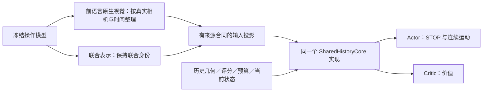

# 搜索核心候选与输入适配边界

本页记录用于结构筛查的实现合同，不把某个候选预先认定为最终主架构。
旧冻结实验仍使用各自的源码；既有结果不能改标成统一核心结果。

## 统一范围

图中 Actor/Critic 各自实例化核心并拥有独立权重，不共享隐藏张量或参数。
视觉与联合表示是不同输入配置，不能因为维度一样就互换；图不表示本轮同时训练两个输入配置。

- 原生读取、网格/时间/相机顺序、池化与投影属于输入适配；操作模型保持冻结。
- 状态融合位置、Context 激活、历史编码与聚合、输出头属于搜索核心，不能按模型名称暗中更改。
- `selectors/unified_search_policy.py` 提供同一个核心，`data/search_core.py` 枚举候选。
- `selectors/search_policy_factory.py` 增加显式 `UNIFIED_NATIVE_CONTINUOUS_POLICY_V1`；旧 schema 继续指向旧网络，不静默迁移。
- 原生配置绑定 `layout`、`projection_groups`、`producer_sha256` 和 `core`。来源摘要进入 checkpoint 身份，同形状但来源不同也拒绝加载。
- 当前统一适配器支持一个 movable/joint 主流及最多一个独立 context 流。单头、外部+腕部、单个真实 joint 均有 CPU 检查；双独立腕部配置明确拒绝，不能称已支持全部本体。

## 四组结构筛查

| 候选 | 状态融合 | Context 映射 | 辅助相机路径 |
|---|---|---|---|
| U0 | History 后 | Linear | Context |
| U1 | History 前 | Linear | Context |
| U2 | History 后 | Linear + Tanh | Context |
| U3 | History 后 | Linear | 查询记录融合 |

所有组采用两层四头 History Transformer、visited mean、独立 Actor/Critic。
U3 包含可学习的两视图加权融合层，均匀初始化；应披露参数差异，不称为只有接线位置改变。
同源初始化并不保证改结构后功能等价；只有 U0 的旧实现输出、梯度及一次更新有严格等价证据。

本轮 π0.5 保持原生前语言视觉、G、P10、Q8、同数据和噪声，每组两种子512回合。
共4096搜索回合、512完整开发操作，使用独立批准的12万调用上限。测试集不参与选结构。
固定终点作为第一轮比较；保存128/256/512检查点不等于已授权所有中间点的操作评测。
比较任务配对成功率、查询数、耗时、策略行为与学习曲线；不能因reward数值高就选择结构。
这是筛查，不足以证明全模型优越或训练收敛。只有开发证据支持时再安排匹配预算确认；
不能将单独有效的组件自动组合成未经测量的 U1+U2+U3。

## 表示候选与真实准入

π0.5、GR00T 当前搜索输入为语言融合前逐相机视觉；RLDX 旧输入为联合认知token。
RLDX 存在前语言视觉读取路径，原先的 joint 选择不是架构强制。
`AlphaBrain/model/rldx_features.py` 是只读候选捕获器，观察一次已有
`get_image_features` 调用，保留返回对象和deepstack输出，按frame-major/camera-minor边界读取。
选择当前帧不意味着去掉视觉塔内的时序感受野。现有联合向量不能强拆成外部/腕部。

当前捕获器通过CPU替身的顺序、空间网格、有限值、RNG、单次调用、失败清理与嵌套拒绝测试；
它未接替生产RLDX路径，也没有真实GPU数值/完整轨迹准入。后续须用真实处理器验证
相机/帧顺序、改指令与逐相机变化的依赖范围，以及动作、flow和Accel不变。
RLDX新表示的GPU验证/训练不包含在本轮π0.5结构预算里。

## 运行与恢复

科学配置和资源绑定分离；使用既有 `PrefixCampaign`、完整批次屏障、center授权和预算账本。
新源码版本通过实际入口准入后才采样。旧controller仍可能领取空闲卡时，瞬间空闲不是资源移交。
只有旧owner停止/显式释放、账本结算且现场GPU/保活身份通过后才能切换。
不明调用不自动重放或退款；没有跨旧owner热撤卡接口时，应如实报告等待，而不是抢占。
