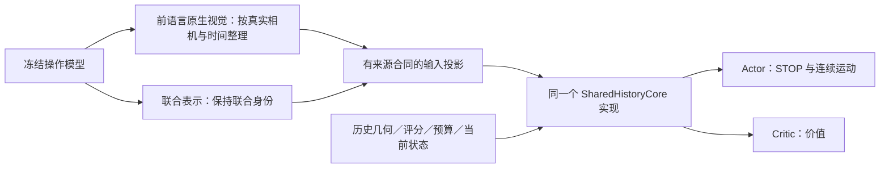

# 搜索核心候选与输入适配边界

本页记录用于结构筛查的实现合同，不把某个候选预先认定为最终主架构。
旧冻结实验仍使用各自的源码；既有结果不能改标成统一核心结果。

## 统一范围

图中 Actor/Critic 各自实例化核心并拥有独立权重，不共享隐藏张量或参数。
视觉与联合表示是不同输入配置，不能因为维度一样就互换；图不表示本轮同时训练两个输入配置。

- 原生读取、网格/时间/相机顺序、池化与投影属于输入适配；操作模型保持冻结。
- 状态融合位置、Context 激活、历史编码与聚合、输出头属于搜索核心，不能按模型名称暗中更改。
- `selectors/unified_search_policy.py` 提供同一个核心，`data/search_core.py` 枚举候选。
- `selectors/search_policy_factory.py` 增加显式 `UNIFIED_NATIVE_CONTINUOUS_POLICY_V1`；旧 schema 继续指向旧网络，不静默迁移。
- 原生配置绑定 `layout`、`projection_groups`、`producer_sha256` 和 `core`。来源摘要进入 checkpoint 身份，同形状但来源不同也拒绝加载。
- 当前统一适配器支持一个 movable/joint 主流及最多一个独立 context 流。单头、外部+腕部、单个真实 joint 均有 CPU 检查；双独立腕部配置明确拒绝，不能称已支持全部本体。

## 四组结构筛查

| 候选 | 状态融合 | Context 映射 | 辅助相机路径 |
|---|---|---|---|
| U0 | History 后 | Linear | Context |
| U1 | History 前 | Linear | Context |
| U2 | History 后 | Linear + Tanh | Context |
| U3 | History 后 | Linear | 查询记录融合 |

所有组采用两层四头 History Transformer、visited mean、独立 Actor/Critic。
U3 包含可学习的两视图加权融合层，均匀初始化；应披露参数差异，不称为只有接线位置改变。
同源初始化并不保证改结构后功能等价；只有 U0 的旧实现输出、梯度及一次更新有严格等价证据。

本轮 π0.5 保持原生前语言视觉、G、P10、Q8、同数据和噪声，每组两种子512回合。
共4096搜索回合、512完整开发操作，使用独立批准的12万调用上限。测试集不参与选结构。
固定终点作为第一轮比较；保存128/256/512检查点不等于已授权所有中间点的操作评测。
比较任务配对成功率、查询数、耗时、策略行为与学习曲线；不能因reward数值高就选择结构。
这是筛查，不足以证明全模型优越或训练收敛。只有开发证据支持时再安排匹配预算确认；
不能将单独有效的组件自动组合成未经测量的 U1+U2+U3。

后续三种子长训将 U12 作为优先主候选，U3 保留查询成本对照；不把开发点估计更高表述为统计上全面优越。512 回合结果属于匹配交互量的筛查，不证明收敛后的组件收益。

完整决策证据位于持久项目根的 `runs/shared-core-decision-20261105/`：
11组短训筛选、U12/U3至4096曲线、同3072权重的部署Q4/Q6/Q8/Q16分开统计。
当前建议U12、无额外T、训练/部署Q8、G与查询成本0.01不变；这是待确认配置，不是新派发许可。
π0.5可保留兼容U12检查点；其他模型不能将旧核心结果改标为此配置。
按三种子共同开发点选择检查点，不逐种子拼最佳，不用最终测试选择。
输入来源、初始化、评分/执行动作长度及真实生产验收仍需分别绑定，不能以共享核心替代。

部署 Q16 诊断使用 Q8 训练的同一组 U12 权重：`continuous_observation` 显式支持最多 15 条历史，缺省仍为 7 条；训练 Gym 仍只接受 Q8。Actor/Critic 使用同一 visited mask，返回重查照常计费。`core_confirmation` 独立闭合协议拒绝 Q16 训练或自动扩预算；该诊断不决定将主配置改成 Q16。

查询上限必须同时绑定搜索器和实际 `RenderedViewSource`，不能仅调整历史长度及账本。本轮曾因源仍固定八次而在第九次查询失败；回归必须经过真实源类和实际 Actor 入口，覆盖超过八次查询及返回计费，不能用替代源掩盖边界。开发修复不修改已冻结在途源码，恢复需独立版本和失败消耗审计。

## 表示候选阶段（历史边界；当前主线见下节）

π0.5、GR00T 当前搜索输入为语言融合前逐相机视觉；RLDX 旧输入为联合认知token。
RLDX 存在前语言视觉读取路径，原先的 joint 选择不是架构强制。
`AlphaBrain/model/rldx_features.py` 是只读候选捕获器，观察一次已有
`get_image_features` 调用，保留返回对象和deepstack输出，按frame-major/camera-minor边界读取。
选择当前帧不意味着去掉视觉塔内的时序感受野。现有联合向量不能强拆成外部/腕部。

当前捕获器通过CPU替身的顺序、空间网格、有限值、RNG、单次调用、失败清理与嵌套拒绝测试；
它未接替生产RLDX路径，也没有真实GPU数值/完整轨迹准入。后续须用真实处理器验证
相机/帧顺序、改指令与逐相机变化的依赖范围，以及动作、flow和Accel不变。
RLDX新表示的GPU验证/训练不包含在本轮π0.5结构预算里。

## 运行与恢复

科学配置和资源绑定分离；使用既有 `PrefixCampaign`、完整批次屏障、center授权和预算账本。
新源码版本通过实际入口准入后才采样。旧controller仍可能领取空闲卡时，瞬间空闲不是资源移交。
只有旧owner停止/显式释放、账本结算且现场GPU/保活身份通过后才能切换。
不明调用不自动重放或退款；没有跨旧owner热撤卡接口时，应如实报告等待，而不是抢占。

## 三模型主实验定型（2026-11-06）

用户已选择 U12：状态在 History 前融合、Context 为 Linear+Tanh、辅助相机走 Context；
两层四头、visited mean、独立 Actor/Critic、无额外 T、G、Q8、查询成本0.01。
三个模型在输入投影后使用同一 `SharedHistoryCore`，不再由模型名选择核心结构。
π0.5 保留已验收的真实视觉适配器及三种子 U12@2048；其旧编码器初始化谱系照常披露。
GR00T 与 RLDX 使用逐相机前语言原生视觉，投影组显式共享；搜索网络随机初始化。
RLDX 的当前帧来自真实四帧输入，原生视觉塔时序作用保留，不将联合认知向量拆成假相机。

`data/unified_mainline.py` 定义独立冻结协议，不改旧协议；`prefix_pilot.policy_for`
将显式原生合同交给统一工厂，Actor 和 Critic 均受同一核心/来源身份检查。
新 RLDX 读取仅在显式 `RLDX_RESET_VISUAL_FEATURE_V1` 下启用，旧 joint 合同保持原路径。
数值准入须比较带捕获和不带捕获的同输入动作/flow/RNG，并走完整操作及真实采集器。
CPU检查通过不能代替该GPU准入。

新模型各三种子训练至3072回合/96更新，保存每512回合的完整恢复检查点。
`prefix_selection.py` 仅消费已结算的开发集面板，按任务宏平均成功率、较少查询、较早更新
顺序选出每模型三种子共用的检查点；六个开发点与所有种子缺一不可。
最终测试不参与选择；所有曲线保留，不将3072称为已证明收敛。
π0.5 的2048是已有开发证据上的回顾性选择，须与新模型预先冻结规则区别披露。

复用已有 `PrefixCampaign`、资源租约和 center authority。一模型的训练与开发评测完成后
即可进入该模型最终评测，无需等待另一个模型；所有调用仍由同一总账本约束。
旧搜索核心结果只留作历史/结构对照；旧 Stay/参考位只有操作模型、传感输入、初始化、
动作/时限和噪声身份完全匹配时才能复用。发布物、预算、初始化、源哈希与准入回执位于
持久根 `runs/unified-libero-mainline-20261106/`；具体准入状态以该目录实时回执为准。

原生模型一批样本可能使用多个不同的冻结模拟配置。资源申请须按实际配置摘要计数，
为每组至少保留一个驻留槽位；不能仅按模型名称或固定三卡申请。`FleetSlots.lease_distributed`
支持一次原子申请多个已准入节点；`assign_runtime_hosts` 在发布清单前完成放置，保留样本、
噪声及任务地址。任一阶段结果不明时，整个租约进入隔离，不自动重发。
已有冻结阶段不热更新：仅在零调用或完整结算审计后移交已隔离资源，新 CPU 编排可以通过
`frozen_stage` 使用原准入源码执行。原账本预留和故障记录保留，显式恢复预算纳入原总上限。
