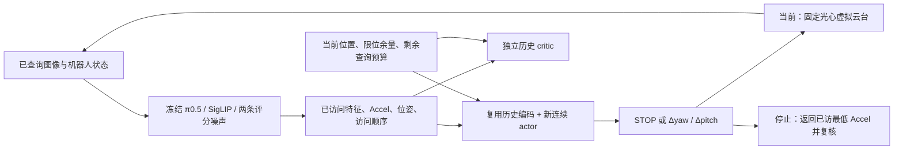

# 连续视角搜索主方案

本方案按用户 2026-10-22 指令取代尚未执行的动态候选 PPO 学习计划。
唯一配置为 `configs/dsol_paper1/search/continuous_search_v1.json`；旧配置和旧结果不改。
动态候选保留给非学习局部 Accel 对照，本轮只准备一套学习策略。
当前授权仅设计、接口、CPU 检查和最多 64 条新增工程去噪轨迹；不训练、不执行操作任务。

## 接口与信息流

actor 不接收未访问候选列表、未访问分数或成功标签。历史保留旧 12 维相对位姿、图像特征、
评分均值/波动、访问顺序/当前位置/最佳位置、腕部特征、预算。
新增归一化当前角度与四个限位余量；合法增量上下界另作分布映射参数。
复用旧 actor 的 `encoder`（包括视觉投影和历史 attention），不复用离散候选输出头。
新角度投影、独立 critic 用 seed=0 初始化；STOP/均值头初始为零，log_std 初始 -0.5。
旧 actor 的成功率不是新策略的初始成功率；新头未经训练。

## 连续分布与 PPO

STOP ~ Bernoulli；继续分支采样二维高斯 z，按当前位置得到每轴
`low=max(-10, -limit-current)`、`high=min(10, limit-current)`，以
`delta=(high+low)/2+(high-low)/2*tanh(z)` 映射成度。
记录 STOP、原始 z、实际增量和旧策略联合 log probability。
继续分支的 log probability 包含 tanh 及状态相关缩放的 Jacobian；STOP 分支只含离散概率。
禁止裁剪后仍用原概率。浮点饱和、非法增量及非有限数值报错，不重采样凑通过。
连续熵采用 Bernoulli 精确熵 + P(继续)×有界连续分布的重参数化单样本熵估计。
部署规则：P(STOP)≥0.5 则停止，否则使用映射后的高斯均值。

critic 使用独立的历史编码与价值头，不看完整 Accel 场。按完整搜索回合计算 GAE，
终点 bootstrap=0，不把下一初态价值接入上一回合。32 回合一更新，16 次更新，
其余 PPO 参数沿用原设计；每个 epoch 保留最后一个不足64条的 minibatch，不追加采样。
当前代码提供网络、概率/损失、Gym、回合目标和分批组件；正式采样、优化、持久日志及恢复的总驱动
仍须接线并通过独立 CPU 集成检查。组件检查不等于完整训练链已准入。

## 相机边界与头部接口

当前是外部相机固定光心代理：yaw ±30°、pitch ±20°，单次每轴≤10°。
连续 actor 不吸附97点，也不受八个动态提议约束；零增量仍算查询，不能免费重抽。
实际头部后端必须显式提供 joint radians、world_from_base、head_from_camera、关节顺序和限位，
输出相机 camera-to-world 及实测位姿/稳定性回执。缺相机外参则拒绝创建，不猜测。
URDF 的长度/角度按米/弧度解释；它声明的速度/力矩尚未硬件核验。
原始 URDF、解析回执和 mesh 只在私有 assets 中，禁止上传。

已读原文：yaw 躯干→颈部，axis=(0,0,1)，origin xyz=(-0.041,0,0.46874)m，rpy=0；
pitch 颈部→头部，axis=(0,0,1)，origin xyz=(0,0,0.06)m，rpy=(-1.5708,0,0)rad。
限位分别约±90°、−23°/+22°；局部轴必须经过 origin 旋转，不能直接等同虚拟相机 yaw/pitch。
未提供相机 frame/内外参；当前没有完整机器人碰撞/速度/成像或光心平移验证。

## 奖励、结束和成本

奖励仍为 `(旧最佳Accel−新最佳Accel)/0.16535300100378683−0.01×新增查询数`。
batch=1、两条配对评分噪声固定；无成功奖励、居中奖励、距离奖励。
预算8：初始1次、最多6次主动查询，保留1次必要的返回复核。
主动 STOP 本身不额外收费，若触发返回则返回查询收费；已在最佳处不重复查。
因此最大决策转移数仍为6：第六次主动查询后自动结束，不能再添加第七次 STOP 转移。
若提前 STOP，它占一个转移。返回中间运动分段≤10°但不评分，运动时间独立记录。
工程失败停止并留存，不作为正常 episode 终点或换新种子重试。

## 唯一划分与预算

训练：A组原8任务、16初态（0/1、4/5、8/9、12/13、16/17、20/21、24/25、28/29），
各32回合，共512；seed=0；只固定状态观察搜索，不执行操作。
起点 yaw[-25,25]、pitch[-15,15]，排除最大绝对角<10°。初态身份以冻结输入清单核对。

| 评价任务 | 初态 | 搜索训练关系 | 操作上限 | 任务数 |
|---|---|---|---:|---:|
| 奶酪入碗 | A 2/3 | 已见任务，留出初态 | 300 | 48 |
| 酒瓶入架 | A 10/11 | 已见任务，留出初态 | 300 | 48 |
| 黑碗放盘 | B 0/1 | 未参与搜索器训练 | 220 | 48 |
| 字母汤罐入篮 | B 4/5 | 未参与搜索器训练 | 280 | 48 |

每初态两个起点(-17.5°,9.5°)/(17.5°,-9.5°)，每方法四执行种子0/1/2/3。
三方法是不调整、动态候选局部 Accel、连续 PPO；同π0.5、初态、范围、评分/执行噪声、预算及操作时限。
每次预测10动作、最多执行5动作后重规划；初始10步稳定过程不计入操作上限。
任务此前已被分析，非盲测；“未见”不针对π0.5预训练。随机搜索不增加到本轮评价。

| 阶段 | 去噪轨迹上限 | 当前授权 |
|---|---:|---|
| 本次新增连续动作工程准入 | 64（含失败、预热） | CPU通过后可运行，无操作任务 |
| 后续512回合搜索训练 | 8192 | 不启动 |
| 后续48搜索会话（16组合×三方法） | 544 | 不启动 |
| 后续192条任务执行，最多52800操作步 | 10560 | 不启动 |
| 后续训练+评价 | **19296** | 设计预算 |
| 本次工程+后续研究 | **19360** | 不等于全部已获运行授权 |

旧64条渲染准入是已花费历史预算，不重复占新64；若全部上限用满，含旧累计19424。
一次去噪轨迹为一个噪声输入的完整10步去噪，不是一次网络前向。

## 本次工程准入与下一关

复用旧四状态A2/A10/B0/B4、源码/模型/噪声身份和精确返回标准。
在两个新计划起点上各采一次固定随机种子的未训练连续 actor 动作，再主动STOP；
独立复核采样新朝向和起始朝向的返回图像/特征/动作/轨迹逐值一致。
这些是工程控制，不报告任务成功率或搜索收益；总调用≤64，预热和失败均计入，不补跑。
沿用标准队列、可信保活身份、真实显存预算和启动前复检；单 worker，不为本次重测48 worker。

训练前还需：完整32回合采样/PPO/保存恢复总驱动的CPU集成；新训练清单绑定源码/模型/噪声/资源；
首次真实训练批次检查（计入8192）及用户授权。评价前首个配对执行块同样计入192条，不额外加任务。
新的操作适配器记录每次输入哈希、执行噪声身份、完整裁剪后10×7动作块和实际执行动作。

奶酪旧两条种子差异作为历史限制保留，不在本轮继续追查；新旧成绩分开，不把旧97点成绩当新基线。
