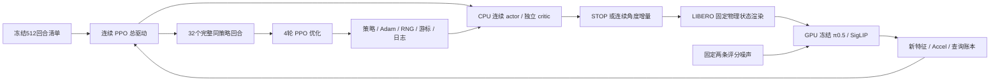

# 连续 PPO 训练驱动与启动边界

科学划分、奖励、噪声和预算只以[连续主方案](continuous_search_zh.md)及其冻结配置为准。
本文说明实现与恢复。2026-10-22首轮512回合训练和192条配对评测已结束。
当前已授权4-worker实现与CPU验证、最多128条真实一致性准入；通过后开始原512回合重训，
首32回合和首次更新检查通过后继续，失败就停，不增加正式任务评测或并发规模。
旧v1配置、源码快照、actor和结果保留。待执行修正版为
`configs/dsol_paper1/search/continuous_search_stop_mixed_v2.json`，不是从旧终点继续训练。

## 代码分工

| 层 | 当前入口 | 职责 |
|---|---|---|
| 连续策略 | `selectors/continuous_search_policy.py` | STOP＋有界二维高斯、独立历史 critic、联合概率和 PPO 损失 |
| 总驱动 | `selectors/continuous_ppo.py` | 完整回合采样、GAE、32回合/更新、4轮优化、日志和恢复 |
| 持久记录 | `data/continuous_training_store.py` | 单写入者、原子提交、输入哈希、随机状态、故障标记 |
| 混合清单 | `data/continuous_training_schedule.py` | 每批全部初态等额配额、原起点/种子逐行保全、独立版本 |
| 实际查询 | `benchmarks/LIBERO/continuous_training.py` | 固定状态渲染、冻结π0.5/SigLIP、两噪声计费；无操作动作 |
| 运行调度 | `benchmarks/LIBERO/continuous_training_queue.py` | 标准队列中的单个驻留worker，可信保活、显存与启动前复检 |

前四项路径均相对于 `AlphaBrain/research/dsol/`。历史 `search_attention_ppo.py`、
`analysis/search_attention_training.py` 继续属于97候选方案；不改旧模型、旧清单或旧结果。
动态候选用于局部非学习对照，不能冒充连续 actor 的输出空间。

CPU actor/critic 与 GPU 操作模型分离；只优化搜索网络。第一版一个进程、一个驻留操作模型，
不使用旧48-worker评价并发方式采集 PPO 回合。Adam 的 eps=1e-5 沿用此前 SB3 默认值，
其余学习率、梯度裁剪、损失系数不变。模型加载和渲染不能消耗搜索 actor 的随机序列。

## 数据、日志与计费

不需要穷举一个新候选表。复用物理初态和语言、相机基准、冻结权重、两个噪声输入及划分清单。
每个连续新位置必须实际查询，训练阶段没有操作成功标签；成功率只能来自后续匹配任务执行。
连续渲染分支不读取旧97点候选表。身份清单里的旧缓存路径不作为训练数据加载。

每回合保存采样前历史、STOP/潜变量/实际角度、旧 log probability、价值与奖励；
另记起始/最佳 Accel、查询次数、结束原因、选中位置。初始查询常数成本单列，并同时记录
含初始成本的总收益。每次更新记录策略损失、critic损失、近似KL、裁剪比例、梯度范数和分批大小。
修正版分别记录探索正则、STOP熵、单位区间运动熵、平均STOP概率；不把新值写进旧 `entropy` 曲线。
新版W&B组为 `continuous-pose-ppo-stop-mixed-v2`；只有匹配新版绑定的运行才能写入。
实际查询逐次保存输入/噪声哈希、完整动作与去噪数组；动作只用于评分，执行动作数必须为0。

开始推理前先持久记录尝试，失败同样占预算。恢复时模型调用账本须等于已提交查询数×2；
不能重新给每个进程分配8192额度。每回合8查询含起始和必要返回；最多6决策转移。

## 恢复与文件保留

一个 actor 连续采32回合后才更新，不能混入旧97点回放或不同策略版本。
支持在已提交回合之后、以及更新边界显式恢复：保存网络、Adam、Python/NumPy/Torch CPU随机状态、
回合游标、更新次数和查询总数。优化器尚未更新的完整回合会原样加载，不重新查询。

采样或更新过程中中断、未提交文件、损坏哈希或故障标记一律停止；不自动回滚重试。
单写入锁阻止两个进程同时恢复同一目录。队列恢复还须核实旧worker已退出；训练器的CPU恢复通过
不代表跨进程GPU数值一致性已完成验收。

每个运行保留初始检查点和最近两次完整检查点，清理本运行更早的可替代优化器快照并留下哈希回执；
完整回合证据、失败记录和历史运行不删。最新固定训练终点为第512回合/第16次更新，不能按评测表现选权重。
产物只进入项目 `runs/<run-id>`；不在工作区根目录散放模型或队列。

## 本轮CPU验证及尚缺步骤

CPU检查实际执行合成数据的优化：完整512回合/16更新，另以4608维网络联调实际查询适配代码，
使用替身渲染器和替身VLA。暂停于第7、32、39回合后恢复，与不中断运行的动作、优化器及最终参数逐值一致。
覆盖真实更新、变长回合、保留不足64条分批、重复写入拒绝、故障停止、哈希篡改、调用预算及检查点保留。
这些结果只证明工程链路，不能画成搜索收益或任务成功率曲线。

新启动清单应绑定源码commit、初始权重、模型/噪声/状态哈希、512训练与48评价会话清单、
已完成36条真实连续动作准入、保活身份规则和资源余量；清单默认拒绝执行。
CLI不带 `--execute` 只读验证；正式执行还要求新的明确训练授权字段。

本轮授权与资源复检已完成。首个真实32回合/首次优化通过：66次查询、132条去噪轨迹，
actor/critic更新及完整查询证据均通过；训练源码冻结为74d1236，首批计入原8192上限。
不追加“预热研究回合”。工程失败停止，未通过时不自动继续第二批。
评价仍是三方法：不调整、局部Accel、连续PPO；四任务/八初态/两起点/四执行种子，共192条任务。
需要在新范围内重新搜索、配对执行，不能查旧97点成功率。随机搜索不加入本轮，也不声称已做其连续空间对照。
真实头部映射仍缺相机标定与运动学/硬件验证，不阻塞当前外部相机代理的训练准备。

## STOP与采样修复：同预算重训，须先通过四worker准入

修复动机来自已保存记录的CPU核查：历史探索项随度/弧度变换改变STOP梯度方向；
最终actor在1,586份已有决策输入上没有一次确定性STOP。旧训练每批只见一个初态，
16批分别来自16个初态，奖励变化不能单独用于判断收敛。未证明这两项是所有效率问题的唯一原因。

新探索项为 `H(Bernoulli) + detach(1-p_stop) * H(tanh(z))`。只移除物理单位及运动项到分支概率的梯度，
不改变物理动作映射、PPO log probability/Jacobian、部署STOP阈值、任务奖励或损失系数。
保留原物理联合熵函数作历史诊断，不用于新优化。网络参数键不变，旧actor可原样部署。
新训练store绑定 `continuous_ppo_complete_episode_v2` 和探索规则；旧目录恢复会拒绝，不能混用优化器。

重排原512条起点记录，每批16初态各2回合（每任务4回合），共16批。
局部seed=0只打乱清单顺序，原角度、物理状态、proposal seed及评分噪声不重新生成。
`source_episode`记录旧行号，`episode`是新采样顺序；任何丢失、重复或内容变更均拒绝。
从与首轮相同的未训练初始化开始，最终固定第16次更新；不得加载已经训练好的v1终点来冒充公平重训。
两项同时修正只能检验组合修复，不能声称已隔离二者各自的因果收益。

| 后续阶段（当前均不启动） | 固定规模 | 去噪轨迹上限 |
|---|---|---:|
| 搜索训练 | 512回合、16更新、seed0、每回合≤8查询、每查询2噪声 | 8,192 |
| 三方法评价搜索 | 8初态×2朝向×3方法，48会话 | 544 |
| 配对真实执行 | 每会话4执行种子，共192条 | 10,560 |
| 研究合计 | 不增加随机搜索或第四种方法 | 19,296 |

四任务、初态和时限不变：奶酪A2/3及酒瓶A10/11各300步，黑碗B0/1为220步，汤罐B4/5为280步；
每5步重规划，执行种子0/1/2/3。先前工程预算64条不转成训练余量；配置保留上限用于历史算术，
新版 `engineering_admission.authorized=false`，下一次真实准入须另列调用清单后授权，不在本轮运行。

验证顺序：CPU概率/梯度/单位不变性→混合清单及哈希→合成完整训练和精确恢复→
真实启动前资源/输入复检→若后续授权，原512预算内的首32回合/第一次更新关卡。
CPU测试不能证明STOP比例或成功率将改善。后续固定报告成功/伤害配对表、查询数及主动STOP/预算结束，
不能用随机训练STOP比例替代确定性部署STOP。奖励曲线用同一批状态组成比较；本轮不额外增加固定面板查询预算。
最终四任务已经反复查看，只算开发验证。查询未减少或成功/伤害变差时保留负结果，不据此扩大规模或调权重追分。

## 四worker采样：实现与独立准入

采用单一中央学习器和多个采样worker；当前瓶颈是采集，暂不做DDP梯度训练。
中央端负责配额、策略版本、优化器和全局账本；worker仅持有固定版本actor与冻结π0.5，执行固定物理状态观察搜索。
核心PPO不导入仿真/SSH；调度复用 `execution/` 标准队列，LIBERO细节留在benchmark适配层。
`selectors/continuous_parallel.py`负责回合独立RNG与严格版本/概率核验、按原顺序导入；
`execution/rollout_budget.py`在跨进程锁内持久化全局预留和消耗；
`benchmarks/LIBERO/continuous_parallel.py`负责每批标准队列、GPU后端、准入及中央学习器。
每批四个独立GPU worker各采8回合，VLA批内驻留；批次结束退出，中央更新后启动下一批。
跨批模型重载可能影响速度，先记录实际吞吐，不把48-worker固定actor评测当作训练容量证明。

1. 每批先固定32个试验身份、actor权重哈希、版本、起点、噪声及独立采样RNG；身份不含host/worker。
2. 配额固定为16初态各2回合；收齐32个同版本完整回合后才更新。按episode顺序归并；不能取最快32个替代指定集合。
3. 更新期间不启动下一版本采样，广播完成并收到确认后才继续。过期版本、重复提交、缺失记录直接阻塞更新。
4. 调度按每次最多8查询/16轨迹预留全局额度；每次实际调用前持久记账，失败消耗额度。中央账本与worker账本核对，禁止各自分配8192上限。
5. 保存actor/optimizer、策略版本、随机状态、已提交轨迹和在途所有权；失败就停，不自动补样。只有证明旧worker退出、记录完整后才能显式恢复。
6. 操作模型保持batch=1，两个配对评分噪声。第一步4个独立GPU采样worker，全局仍32回合/更新；初态在worker间交错分配。
7. 本轮固定4worker。三机24/48不在本次授权内，须独立容量检查和方案确认。

CPU覆盖：4进程共享一个预算；失败尝试仍计费、重复query/member/版本拒绝；
串行与4进程逆序返回的32回合逐值一致；全部验证后才导入和更新；恢复已提交完整批次不重复采样。
新RNG按固定root seed、source_episode及proposal_seed派生，独立于host/worker；
不承诺复现旧串行全局RNG链的随机动作。源码、策略版本和独立RNG规则均绑定新清单。
完整批次可只读复验后显式导入；未完成队列、预算失败或疑似在途worker一律拒绝自动恢复。
底层推理失败由预算共享失败标记阻止后续派发，标准队列终止所属实验进程，保活进程不受影响。

真实准入：固定训练初态0/8/16/24，各一次串行及并行完整搜索，最多8×8×2=128轨迹；
计入预热及失败，不执行操作动作。逐值核对actor动作/概率/value、像素、物理状态、位姿、完整动作块、
去噪轨迹、SigLIP、评分和查询数；不放宽阈值。通过回执必须由训练入口校验哈希，未通过不能开始训练。
这128条是本次单列工程预算，不从旧64条准入或正式训练余量借用；本次总上限128+8192=8320。
后续评价方案仍544+10560，但本次不自动执行。W&B使用独立run与stop-mixed-v2组。

## 原生模型与驻留采样接入

新运行使用 `search_runtime.create_policy_runtime` 显式选择后端。项目后训练模型继续使用
原加载器；原生 OpenPI 保留32维内部动作和原生 quantile 预处理/解码，不得回退到项目
mean/std 加载器。原生特征来自同次视觉前向；旁路记录实际十步去噪速度，完整32维轨迹
保存，Accel只用前7个执行通道，仍采用原 prefix=3 公式。输入七维噪声保持逐值不变，
额外25维采用历史独立域生成器，其种子固定绑定原噪声张量的SHA256，不依赖视角或worker。
这不是相同32维动作头条件下仅改变后训练数据的因果对照。

原生工程额度总共128条，已被否决的零步尝试消耗20条；剩余108条拆为：
24条四状态原生无捕获/有捕获动作一致性与返回复核，84条串行/四worker/跨批驻留复核。
后者先采串行参考，后续按参考的实际查询数预留预算；超过预留或剩余额度就停止，
不得靠缩短路径或丢弃初态放行。预热和失败调用也计入；本次不新增规范模型或多视角组的
科学训练，不借用其剩余预算。训练仍512回合、16更新、8192条上限，首32回合单独检查。

`continuous_resident` 通过标准队列持有进程；`execution/resident_mailbox.py` 负责不可变请求、
版本确认、完整回执和有界等待。每批 actor 和 critic 重新载入已发布快照，冻结 VLA 跨批
复用；预算所有权和输出记录按批隔离。工作进程核验中央进程的PID/启动身份，失联停止。
中央异常时队列清理所属进程，不自动恢复不完整驻留池。跨批精确准入未通过时，训练入口
拒绝该生命周期；现有活跃冻结源码仍使用其原采样器。

更细计时分别记录模型准备和模拟器启动。模型为延迟加载，旧日志中首次加载已包含在
worker循环内；此前循环外耗时不能解释为全部加载开销。

四状态原生捕获/返回实际24条、串行/四worker/跨批驻留实际36条均已通过。
剩余48条用于八worker首批与复用批，每批复制同四状态各两次，保留原source_episode和
proposal_seed，仅使用新记录编号。逐条与既有串行参考核对，不把复制样本当泛化证据。
根据已知参考每批24条，两个批次48条，仍在原128条条件额度内（包括被否决的20条）。
八worker通过后允许每worker采4回合，仍32回合/更新、512回合/16更新；训练入口要求
准入回执的worker数与实际资源槽一致。失败仍停，不拿四worker回执替代八worker容量认证。

最终权重使用 `selectors/continuous_export.py` 导出：必须完整结束、最后更新、预算清零，
并核对全部回合收据。CPU部署控制固定取前16个回合的首次观察，不按奖励挑权重。
规范视角对照由 `benchmarks/LIBERO/continuous_nominal.py` 复用同一配对输入、执行噪声和
时限，每模型8初态×4执行种子=32条、执行调用上限1760；不重复两个扰动起点，不做评分
或搜索。该基线与三方法192条任务分别计数，尚未因工程准入而自动启动。

2026-10-22 实测：八worker冷/热两批48条已逐值通过，进程正常退出；随后原生组使用
新冻结源码 `eb42fda` 启动512回合训练。每worker一个回合的工程检查中，首次采样循环
95.4–106.6秒，复用后9.8–11.3秒，模型准备从86.3–93.6秒降至约0.003秒。
这是小规模准入计时，不能解释为整轮训练同比提速；完整32回合批次与优化耗时另行记录。
规范/多视角组分别完整结束于约67.9/66.7分钟，最终actor与16份CPU控制已冻结。
两组新配对/规范清单通过输入核验，尚未开始操作任务评测；不能把训练奖励当成功率。

## 完整训练收尾与扩规模准备（规划，不启动）

三组均已完成512回合/16更新。规范组耗时4075.1秒、1681查询，多视角组3999.0秒、
1144查询，原生驻留八worker组1596.5秒、853查询。原生组八个worker正常退出，
W&B已记录16次更新，最终actor按既定规则导出并通过16份CPU部署控制。
三组查询量、操作模型和依赖栈不同，不能将67分钟与27分钟之比当作调度优化的纯加速比。

原生组16批的最长worker循环累计804.0秒，优化累计3.29秒，每回合模拟器启动均值
8.32秒。总耗时减去前两者约789.2秒，只是尚未细分的循环外时间，包含启动、发布、
汇总、校验和提交等；不是已证明的共享盘耗时，也不是全部可消除的空转。
下一冻结版本优先补齐这些阶段的独立计时。小型actor/critic的梯度更新目前不是瓶颈。

### 工程工作与科学评测并行推进

无需等所有任务评测结束才开发。源码、CPU故障测试、静态数据划分和预算可并行准备；
运行代码的切换发生在新清单和独立准入之后，不热改在途实验。

| 顺序 | 具体交付 | 验收和边界 |
| --- | --- | --- |
| 1：评测分块 | 复用统一队列，将一个物理初态×起始朝向的三方法×四种子作为12任务配对块；规范视角另按初态分块 | 全局科学地址无重复、无缺失，评分搜索只做一次供四执行种子复用；按原任务时限累计配额，绝不能给每个worker各发整轮预算 |
| 2：采样链路 | 测量发布、结果校验、账本、存档；准备节点本地暂存与持久盘提交接口 | 未持久化且未核验的回合不进入更新；机器掉线不能让临时盘结果成为唯一证据。持久模型已完成，模拟器复用另做状态/像素/轨迹准入 |
| 3：跨机同一PPO | 先验证两机16个collector，32回合每worker两个；中央学习器统一发布版本、分配回合和记账 | 断联、旧版本、重复回执、PID复用、预算耗尽、部分批次恢复均做CPU测试；真实准入不能复用单机8worker的证明 |
| 4：更高并发 | 三机24卡优先承载独立评测块或不同训练种子 | 不把24/48worker当默认最优。32回合无法24份等分；如未来做动态分发，必须保留全部预定回合，禁止只取最快32份或混入旧策略 |

通用身份、远端进程、所有权、预算和恢复放在 `execution/`；PPO批次与策略版本放在
`selectors/`，模型/仿真在benchmark适配器；报告与W&B只读结果。提取仍位于RoboCasa的
共用进程后端时保持薄兼容入口，不复制第三份调度器。跨机预算以单一协调器的持久账本为
权威，worker领取有界配额；不直接假定现有共享文件锁已在多主机下通过认证。

评测可优先按模型分配Fresh/Video/GNU，每机多槽；这已能同时使用三台机器，不要求
先实现跨机联合更新一个PPO。首个三方法配对块仍包含在原192任务中，检查输入、噪声和
执行链，不以成功率决定是否放行。需要额外重复的工程轨迹须先另列预算，不能借用已耗尽
的原生128条工程额度。新增代码的CPU通过也不表示已完成新的真实准入。

### 下一轮规模草案

先完成现有三模型各192配对任务＋32规范任务，判断操作能力、搜索收益与换位伤害。
扩规模先围绕原定规范视角后训练的主模型规划，不按这轮PPO谁赢临时换主模型，也不同时
将三个模型、多个新奖励和网络一起扩训。原生/多视角继续作为已预定的条件对照。

| 项目（当前不启动） | 规模与预算 | 数据准备要求 |
| --- | --- | --- |
| 首轮扩大训练 | 8训练任务×8物理初态×32搜索回合＝2048回合；仍32回合/更新，共64更新；一个种子，最多32768条评分去噪轨迹 | 目标64训练初态，当前仅16个已绑定；新增48个须从官方初态恢复并准入。优先核对每任务官方索引0/1及4–9，排除原评价2/3；不能把重复采样当作新增初态 |
| 扩大真实评测 | 已有A组16留出初态＋B组16初态，覆盖16任务；2起点×4执行种子×3方法＝768任务，另128规范任务 | 已有身份记录可复用，但连续渲染、噪声及任务时限须逐项绑定；当前只有4任务经过本轮协议准备，不能称16任务已完成连续执行准入 |
| 训练种子确认 | 若主方法值得保留，预先固定3个RL种子；每个2048回合，训练评分总上限98304 | 初态划分和超参数冻结；三个种子全部报告，不挑最好actor。执行种子与RL训练种子分开 |

扩大评价的单个操作模型/单个actor上限：评分2176条，配对操作执行53760条，规范操作
执行8960条，共64896条去噪轨迹、896条操作任务。时限沿用各suite的220/280/300/520步，
不统一缩短；这是未来草案，不替换当前四任务192＋32的冻结清单。
三训练种子的评价预算须另行冻结，不将上述单actor额度误当三actor总额；不调整与确定性
局部搜索的结果可在身份完全相同且预先规定时复用，不重复算作独立证据。

这些任务过去已被分析，不能叫盲测；B仅表示未用于搜索器训练，不保证操作模型未见，
不同任务也不自动代表独立场景。新增训练初态、任务/场景分组和泄漏检查完成后才能冻结
划分。若扩大训练同时增加初态和更新次数，结果是扩大方案的联合效果，不单独归因于
其中一项。现有驱动/验证器中的512、16更新、8192等固定值也必须先改为协议驱动，并用
旧512方案的等价测试验证；修改数字不等于具备扩规模能力。

完成当前匹配评价前不启动此草案。首先要求无工程缺失、成败标签完整、规范视角操作
能力可解释；若PPO相对局部Accel或不调整出现明确伤害，先定位再扩。统计不明确时仍
保留不确定性，不靠增加训练直到某次成功，也不把所有技术债清零当作开展评测的前提。
