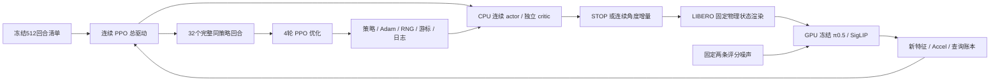

# 连续 PPO 训练驱动与启动边界

科学划分、奖励、噪声和预算只以[连续主方案](continuous_search_zh.md)及其冻结配置为准。
本文说明实现与恢复。2026-10-22首轮512回合训练和192条配对评测已结束。
当前仅授权STOP探索项和混合采样修复、CPU验证及下一轮方案准备，不授权新训练。
旧v1配置、源码快照、actor和结果保留。待执行修正版为
`configs/dsol_paper1/search/continuous_search_stop_mixed_v2.json`，不是从旧终点继续训练。

## 代码分工

| 层 | 当前入口 | 职责 |
|---|---|---|
| 连续策略 | `selectors/continuous_search_policy.py` | STOP＋有界二维高斯、独立历史 critic、联合概率和 PPO 损失 |
| 总驱动 | `selectors/continuous_ppo.py` | 完整回合采样、GAE、32回合/更新、4轮优化、日志和恢复 |
| 持久记录 | `data/continuous_training_store.py` | 单写入者、原子提交、输入哈希、随机状态、故障标记 |
| 混合清单 | `data/continuous_training_schedule.py` | 每批全部初态等额配额、原起点/种子逐行保全、独立版本 |
| 实际查询 | `benchmarks/LIBERO/continuous_training.py` | 固定状态渲染、冻结π0.5/SigLIP、两噪声计费；无操作动作 |
| 运行调度 | `benchmarks/LIBERO/continuous_training_queue.py` | 标准队列中的单个驻留worker，可信保活、显存与启动前复检 |

前四项路径均相对于 `AlphaBrain/research/dsol/`。历史 `search_attention_ppo.py`、
`analysis/search_attention_training.py` 继续属于97候选方案；不改旧模型、旧清单或旧结果。
动态候选用于局部非学习对照，不能冒充连续 actor 的输出空间。

CPU actor/critic 与 GPU 操作模型分离；只优化搜索网络。第一版一个进程、一个驻留操作模型，
不使用旧48-worker评价并发方式采集 PPO 回合。Adam 的 eps=1e-5 沿用此前 SB3 默认值，
其余学习率、梯度裁剪、损失系数不变。模型加载和渲染不能消耗搜索 actor 的随机序列。

## 数据、日志与计费

不需要穷举一个新候选表。复用物理初态和语言、相机基准、冻结权重、两个噪声输入及划分清单。
每个连续新位置必须实际查询，训练阶段没有操作成功标签；成功率只能来自后续匹配任务执行。
连续渲染分支不读取旧97点候选表。身份清单里的旧缓存路径不作为训练数据加载。

每回合保存采样前历史、STOP/潜变量/实际角度、旧 log probability、价值与奖励；
另记起始/最佳 Accel、查询次数、结束原因、选中位置。初始查询常数成本单列，并同时记录
含初始成本的总收益。每次更新记录策略损失、critic损失、近似KL、裁剪比例、梯度范数和分批大小。
修正版分别记录探索正则、STOP熵、单位区间运动熵、平均STOP概率；不把新值写进旧 `entropy` 曲线。
新版W&B组为 `continuous-pose-ppo-stop-mixed-v2`；只有匹配新版绑定的运行才能写入。
实际查询逐次保存输入/噪声哈希、完整动作与去噪数组；动作只用于评分，执行动作数必须为0。

开始推理前先持久记录尝试，失败同样占预算。恢复时模型调用账本须等于已提交查询数×2；
不能重新给每个进程分配8192额度。每回合8查询含起始和必要返回；最多6决策转移。

## 恢复与文件保留

一个 actor 连续采32回合后才更新，不能混入旧97点回放或不同策略版本。
支持在已提交回合之后、以及更新边界显式恢复：保存网络、Adam、Python/NumPy/Torch CPU随机状态、
回合游标、更新次数和查询总数。优化器尚未更新的完整回合会原样加载，不重新查询。

采样或更新过程中中断、未提交文件、损坏哈希或故障标记一律停止；不自动回滚重试。
单写入锁阻止两个进程同时恢复同一目录。队列恢复还须核实旧worker已退出；训练器的CPU恢复通过
不代表跨进程GPU数值一致性已完成验收。

每个运行保留初始检查点和最近两次完整检查点，清理本运行更早的可替代优化器快照并留下哈希回执；
完整回合证据、失败记录和历史运行不删。最新固定训练终点为第512回合/第16次更新，不能按评测表现选权重。
产物只进入项目 `runs/<run-id>`；不在工作区根目录散放模型或队列。

## 本轮CPU验证及尚缺步骤

CPU检查实际执行合成数据的优化：完整512回合/16更新，另以4608维网络联调实际查询适配代码，
使用替身渲染器和替身VLA。暂停于第7、32、39回合后恢复，与不中断运行的动作、优化器及最终参数逐值一致。
覆盖真实更新、变长回合、保留不足64条分批、重复写入拒绝、故障停止、哈希篡改、调用预算及检查点保留。
这些结果只证明工程链路，不能画成搜索收益或任务成功率曲线。

新启动清单应绑定源码commit、初始权重、模型/噪声/状态哈希、512训练与48评价会话清单、
已完成36条真实连续动作准入、保活身份规则和资源余量；清单默认拒绝执行。
CLI不带 `--execute` 只读验证；正式执行还要求新的明确训练授权字段。

本轮授权与资源复检已完成。首个真实32回合/首次优化通过：66次查询、132条去噪轨迹，
actor/critic更新及完整查询证据均通过；训练源码冻结为74d1236，首批计入原8192上限。
不追加“预热研究回合”。工程失败停止，未通过时不自动继续第二批。
评价仍是三方法：不调整、局部Accel、连续PPO；四任务/八初态/两起点/四执行种子，共192条任务。
需要在新范围内重新搜索、配对执行，不能查旧97点成功率。随机搜索不加入本轮，也不声称已做其连续空间对照。
真实头部映射仍缺相机标定与运动学/硬件验证，不阻塞当前外部相机代理的训练准备。

## STOP与采样修复：同预算下一轮，当前不运行

修复动机来自已保存记录的CPU核查：历史探索项随度/弧度变换改变STOP梯度方向；
最终actor在1,586份已有决策输入上没有一次确定性STOP。旧训练每批只见一个初态，
16批分别来自16个初态，奖励变化不能单独用于判断收敛。未证明这两项是所有效率问题的唯一原因。

新探索项为 `H(Bernoulli) + detach(1-p_stop) * H(tanh(z))`。只移除物理单位及运动项到分支概率的梯度，
不改变物理动作映射、PPO log probability/Jacobian、部署STOP阈值、任务奖励或损失系数。
保留原物理联合熵函数作历史诊断，不用于新优化。网络参数键不变，旧actor可原样部署。
新训练store绑定 `continuous_ppo_complete_episode_v2` 和探索规则；旧目录恢复会拒绝，不能混用优化器。

重排原512条起点记录，每批16初态各2回合（每任务4回合），共16批。
局部seed=0只打乱清单顺序，原角度、物理状态、proposal seed及评分噪声不重新生成。
`source_episode`记录旧行号，`episode`是新采样顺序；任何丢失、重复或内容变更均拒绝。
从与首轮相同的未训练初始化开始，最终固定第16次更新；不得加载已经训练好的v1终点来冒充公平重训。
两项同时修正只能检验组合修复，不能声称已隔离二者各自的因果收益。

| 后续阶段（当前均不启动） | 固定规模 | 去噪轨迹上限 |
|---|---|---:|
| 搜索训练 | 512回合、16更新、seed0、每回合≤8查询、每查询2噪声 | 8,192 |
| 三方法评价搜索 | 8初态×2朝向×3方法，48会话 | 544 |
| 配对真实执行 | 每会话4执行种子，共192条 | 10,560 |
| 研究合计 | 不增加随机搜索或第四种方法 | 19,296 |

四任务、初态和时限不变：奶酪A2/3及酒瓶A10/11各300步，黑碗B0/1为220步，汤罐B4/5为280步；
每5步重规划，执行种子0/1/2/3。先前工程预算64条不转成训练余量；配置保留上限用于历史算术，
新版 `engineering_admission.authorized=false`，下一次真实准入须另列调用清单后授权，不在本轮运行。

验证顺序：CPU概率/梯度/单位不变性→混合清单及哈希→合成完整训练和精确恢复→
真实启动前资源/输入复检→若后续授权，原512预算内的首32回合/第一次更新关卡。
CPU测试不能证明STOP比例或成功率将改善。后续固定报告成功/伤害配对表、查询数及主动STOP/预算结束，
不能用随机训练STOP比例替代确定性部署STOP。奖励曲线用同一批状态组成比较；本轮不额外增加固定面板查询预算。
最终四任务已经反复查看，只算开发验证。查询未减少或成功/伤害变差时保留负结果，不据此扩大规模或调权重追分。

## 多worker采样：设计已定，分布式实现与真实准入尚未完成

采用单一中央学习器和多个采样worker；当前瓶颈是采集，暂不做DDP梯度训练。
中央端负责配额、策略版本、优化器和全局账本；worker仅持有固定版本actor与冻结π0.5，执行固定物理状态观察搜索。
核心PPO不导入仿真/SSH；调度复用 `execution/` 标准队列，LIBERO细节留在benchmark适配层。
当前已实现的单驻留worker驱动不能直接扩成48个各自更新的训练器。

1. 每批先固定32个试验身份、actor权重哈希、版本、起点、噪声及独立采样RNG；身份不含host/worker。
2. 配额固定为16初态各2回合；收齐32个同版本完整回合后才更新。按episode顺序归并；不能取最快32个替代指定集合。
3. 更新期间不启动下一版本采样，广播完成并收到确认后才继续。过期版本、重复提交、缺失记录直接阻塞更新。
4. 调度按每次最多8查询/16轨迹预留全局额度；每次实际调用前持久记账，失败消耗额度。中央账本与worker账本核对，禁止各自分配8192上限。
5. 保存actor/optimizer、策略版本、随机状态、已提交轨迹和在途所有权；失败就停，不自动补样。只有证明旧worker退出、记录完整后才能显式恢复。
6. 操作模型保持batch=1，两个配对评分噪声。第一步4个独立GPU采样worker，全局仍32回合/更新；初态在worker间交错分配。
7. 4worker通过协议、轨迹和吞吐检查后才考虑三机24worker；48worker不是默认值，须独立测显存峰值、余量和数值一致性。

尚需实现并验证：中央批次协调器、逐回合独立策略RNG、全局调用预留/结算、版本广播/屏障、跨worker故障恢复。
串行/并行应先共用独立回合RNG再核对，不能承诺与旧串行全局RNG链逐值一致。
真实并行准入预算尚未授权；不能借CPU准备启动模型、复制旧48-worker评测队列或改变保活策略。
