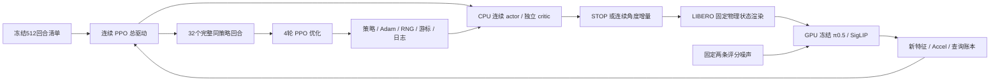

# 连续 PPO 训练驱动与启动边界

科学划分、奖励、噪声和预算只以[连续主方案](continuous_search_zh.md)及其冻结配置为准。
本文说明实现与恢复，不另立训练方案。2026-10-22已授权正式训练；首32回合/首次更新通过后继续原512回合预算。

## 代码分工

| 层 | 当前入口 | 职责 |
|---|---|---|
| 连续策略 | `selectors/continuous_search_policy.py` | STOP＋有界二维高斯、独立历史 critic、联合概率和 PPO 损失 |
| 总驱动 | `selectors/continuous_ppo.py` | 完整回合采样、GAE、32回合/更新、4轮优化、日志和恢复 |
| 持久记录 | `data/continuous_training_store.py` | 单写入者、原子提交、输入哈希、随机状态、故障标记 |
| 实际查询 | `benchmarks/LIBERO/continuous_training.py` | 固定状态渲染、冻结π0.5/SigLIP、两噪声计费；无操作动作 |
| 运行调度 | `benchmarks/LIBERO/continuous_training_queue.py` | 标准队列中的单个驻留worker，可信保活、显存与启动前复检 |

前三项路径均相对于 `AlphaBrain/research/dsol/`。历史 `search_attention_ppo.py`、
`analysis/search_attention_training.py` 继续属于97候选方案；不改旧模型、旧清单或旧结果。
动态候选用于局部非学习对照，不能冒充连续 actor 的输出空间。

CPU actor/critic 与 GPU 操作模型分离；只优化搜索网络。第一版一个进程、一个驻留操作模型，
不使用旧48-worker评价并发方式采集 PPO 回合。Adam 的 eps=1e-5 沿用此前 SB3 默认值，
其余学习率、梯度裁剪、损失系数不变。模型加载和渲染不能消耗搜索 actor 的随机序列。

## 数据、日志与计费

不需要穷举一个新候选表。复用物理初态和语言、相机基准、冻结权重、两个噪声输入及划分清单。
每个连续新位置必须实际查询，训练阶段没有操作成功标签；成功率只能来自后续匹配任务执行。
连续渲染分支不读取旧97点候选表。身份清单里的旧缓存路径不作为训练数据加载。

每回合保存采样前历史、STOP/潜变量/实际角度、旧 log probability、价值与奖励；
另记起始/最佳 Accel、查询次数、结束原因、选中位置。初始查询常数成本单列，并同时记录
含初始成本的总收益。每次更新记录策略损失、critic损失、熵、近似KL、裁剪比例、梯度范数和分批大小。
实际查询逐次保存输入/噪声哈希、完整动作与去噪数组；动作只用于评分，执行动作数必须为0。

开始推理前先持久记录尝试，失败同样占预算。恢复时模型调用账本须等于已提交查询数×2；
不能重新给每个进程分配8192额度。每回合8查询含起始和必要返回；最多6决策转移。

## 恢复与文件保留

一个 actor 连续采32回合后才更新，不能混入旧97点回放或不同策略版本。
支持在已提交回合之后、以及更新边界显式恢复：保存网络、Adam、Python/NumPy/Torch CPU随机状态、
回合游标、更新次数和查询总数。优化器尚未更新的完整回合会原样加载，不重新查询。

采样或更新过程中中断、未提交文件、损坏哈希或故障标记一律停止；不自动回滚重试。
单写入锁阻止两个进程同时恢复同一目录。队列恢复还须核实旧worker已退出；训练器的CPU恢复通过
不代表跨进程GPU数值一致性已完成验收。

每个运行保留初始检查点和最近两次完整检查点，清理本运行更早的可替代优化器快照并留下哈希回执；
完整回合证据、失败记录和历史运行不删。最新固定训练终点为第512回合/第16次更新，不能按评测表现选权重。
产物只进入项目 `runs/<run-id>`；不在工作区根目录散放模型或队列。

## 本轮CPU验证及尚缺步骤

CPU检查实际执行合成数据的优化：完整512回合/16更新，另以4608维网络联调实际查询适配代码，
使用替身渲染器和替身VLA。暂停于第7、32、39回合后恢复，与不中断运行的动作、优化器及最终参数逐值一致。
覆盖真实更新、变长回合、保留不足64条分批、重复写入拒绝、故障停止、哈希篡改、调用预算及检查点保留。
这些结果只证明工程链路，不能画成搜索收益或任务成功率曲线。

新启动清单应绑定源码commit、初始权重、模型/噪声/状态哈希、512训练与48评价会话清单、
已完成36条真实连续动作准入、保活身份规则和资源余量；清单默认拒绝执行。
CLI不带 `--execute` 只读验证；正式执行还要求新的明确训练授权字段。

本轮授权与资源复检已完成。首个真实32回合/首次优化通过：66次查询、132条去噪轨迹，
actor/critic更新及完整查询证据均通过；训练源码冻结为74d1236，首批计入原8192上限。
不追加“预热研究回合”。工程失败停止，未通过时不自动继续第二批。
评价仍是三方法：不调整、局部Accel、连续PPO；四任务/八初态/两起点/四执行种子，共192条任务。
需要在新范围内重新搜索、配对执行，不能查旧97点成功率。随机搜索不加入本轮，也不声称已做其连续空间对照。
真实头部映射仍缺相机标定与运动学/硬件验证，不阻塞当前外部相机代理的训练准备。
