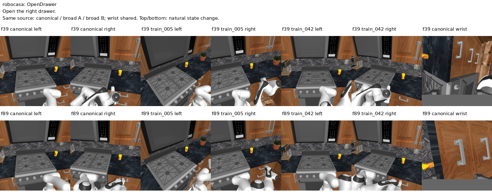
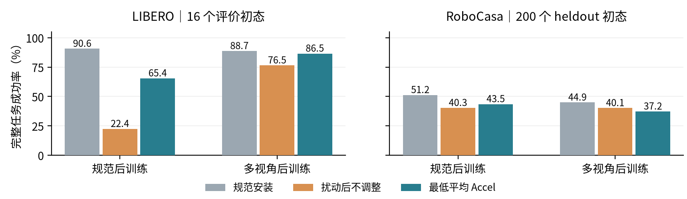
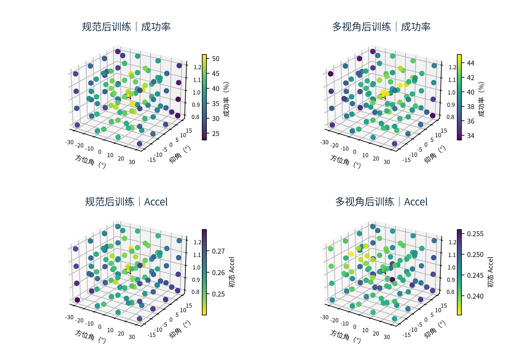
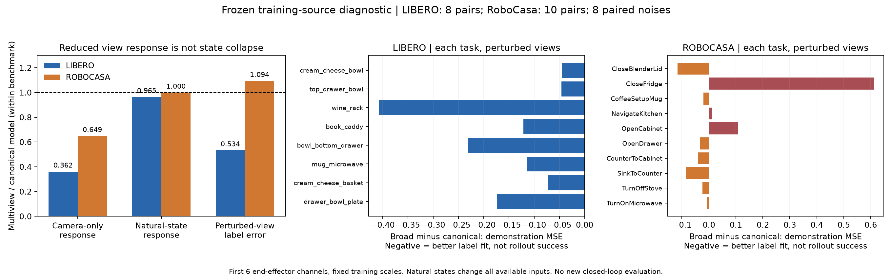

# 科研进展双周报

汇报人：龙君昱　　学号：26B951131

汇报周期：2026 年 9 月 10 日—9 月 23 日　｜　整理日期：9 月 24 日

## 一、本期完成：RoboCasa 多视角训练与闭环评测

图 1　匹配训练。多视角组从 64 个安装中分配，并非每帧渲染 64 次。左右相机联动、腕部安装不变，随底盘自然运动。相同 all_lora 配置，含视觉编码器等参数更新。

图 2　打开抽屉训练样本：从左至右为规范双视图、扰动 A 双视图、扰动 B 双视图及共享腕部图；上下为两个真实时刻。同一时刻只改外部视角，不改状态、语言及动作标签。

双机完成 400 初态 × 97 视角 × 2 模型 × 4 执行噪声，共 310,400 次完整任务；每格另保留 8 套 Accel 评分噪声。评价为 10 个已知原子任务，seen／heldout 各 200 初态；heldout 留出布局与风格，不是未见任务。

## 二、发现问题：LIBERO 的恢复效果未直接迁移

图 3　初态选安装，随后完整执行。LIBERO：16 初态、每候选 32 次；RoboCasa：200 heldout 初态、每候选 4 次。扰动平均 32 个留出安装；Accel 从 97 候选选取。跨环境模型链路等条件不同。

最低 Accel 相对扰动不调整：LIBERO 为 +43.02／+10.06 pp；RoboCasa 仅 +3.24／−2.89 pp（规范／多视角模型）。问题不仅是收益变小，多视角模型上甚至出现负收益。

## 三、Accel 空间分析：低值区与高成功率区不再稳定对应

图 4　RoboCasa 的 96 个非规范安装点，星号为规范安装；上行为完整任务成功率，下行为初态 Accel。先平均 200 个 heldout 初态及噪声。亮色分别表示高成功率、低 Accel；各图独立色条，相同颜色不代表同值。坐标是方位角／仰角／半径倍率，非世界坐标；均为实测，不插值。

| 同一候选总体 | 规范后训练 | 多视角后训练 |
|---|---|---|
| Accel 均值 | 0.2597 | 0.2445 |
| 空间秩相关：−Accel 与成功率 | 0.865 | 0.347 |
| 各初态先转排名，再平均的空间相关 | 0.878 | 0.318 |

图中规范模型的低 Accel 区域与高成功率区域较吻合；多视角模型的评分偏好发生改变。改成相对排名后关联仍弱，不能用“任务间绝对值尺度不同”解释。这里的相关性是平均空间结构，不代表每个初态都能准确选点。

### 进一步发现：既有差区域改善，也有好区域退化

| 按规范模型 Accel 固定分区 | 规范成功率 | 多视角成功率 | 变化 |
|---|---|---|---|
| 原最低 Accel 的 1/4 位置 | 45.15% | 41.55% | −3.60 pp |
| 原最高 Accel 的 1/4 位置 | 29.71% | 37.17% | +7.46 pp |

当前判断：多视角训练改变了视角敏感性与评分排序，不是所有视角都变差。两模型 Accel 场的排名相关仅 0.407，而成功率场为 0.753；指标偏好的改变大于任务表现空间的改变。

Accel 衡量去噪时间上的相对速度变化，本报告采用初态、前 3 个去噪速度及 8 次评分均值；不是机器人运动加速度，也不是整条任务的评分。多视角终点低于规范终点，不等于已证明低于官方起点。

## 四、原因排查：已确认什么，还有什么未解释

图 5　3,168 次动作块生成诊断，非新增闭环。左：多视角／规范模型之比；两环境换视角响应均减弱，但真实状态响应基本保留。右：扰动图上的逐任务示范动作误差变化，负值为改善；LIBERO 的改善更一致，RoboCasa 存在明显任务差异。

### 已核查：不只是计算错误，也不是全局动作塌缩

原始评分重算逐值通过；低值主要来自分子减小，非分母膨胀。相对排名、输出动作维度、完整去噪等口径未消除弱关联。抽样标签对齐；两模型仍响应真实状态，但相机不变性增强并不保证动作质量提高。

### 解释与边界：动作生成更稳定，不等于视角价值更高

训练优化流匹配动作目标，并未监督 Accel 排列任务价值，因而不保证低 Accel 带来高成功率。该解释与现象相容，尚非唯一根因证明。视角覆盖密度、规范样本被替换、腕部／状态依赖、训练预算及后续控制失败仍待区分。

工程核查：纠正新补 LIBERO 原生基线的动作解码失配并重评 640 次；旧零分不再作为基线，正确链路规范成功率为 92.97%。RoboCasa 渲染微差已标定，但同噪声闭环不保证逐位一致，不能把每格 4 次得到的经验 Oracle 当作稳定上限。

## 五、下一步：先收敛问题，再决定方法路线

优先结合现有逐任务图与中间权重，区分“关键视觉证据未被利用”和“观察足够但后续控制失败”，再确定小规模配对验证。是否调整训练配方、设计替代指标，或进入主动观察框架核验，均待本轮诊断审阅后决定；暂不预设切换平台或引入 RL。

## 六、本期论文阅读与参考（独立于实验结论）

| 论文 | 主要参考内容 |
|---|---|
| SaPaVe [1] | 相机／操作动作解耦、两阶段训练及主动操作数据构造。 |
| ActiveArena [2] | 主动感知任务、记忆与 ID／OOD 评价协议；作为可选平台参考。 |
| AAWR [3] | 训练期特权价值估计与优势加权学习，不局限于复现相机示范。 |
| EgoAVFlow [4] | 3D flow 与可见性奖励引导视角，参考非 Accel 的优化目标。 |

[1] arXiv:2603.12193　[2] arXiv:2609.24124　[3] arXiv:2512.01188　[4] arXiv:2602.22461。上述工作尚未在本项目完成复现对照；参考不等于已确定采用其框架。
