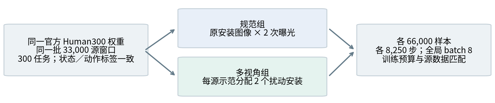
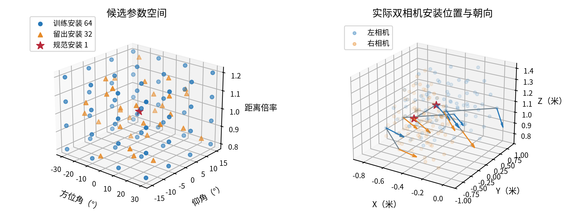
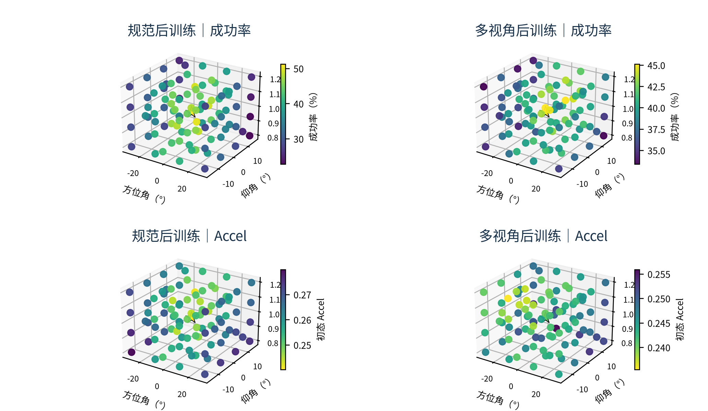
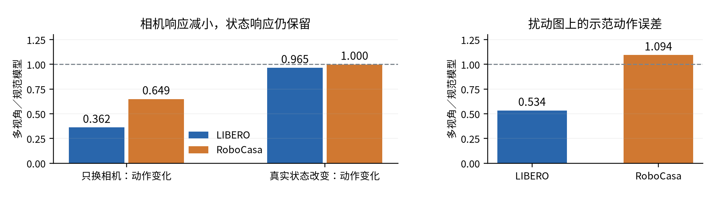

# 科研进展双周报

汇报人：龙君昱　　学号：26B951131

汇报周期：2026 年 9 月 10 日—9 月 23 日　｜　整理日期：9 月 24 日

## 一、本期完成：RoboCasa 多视角训练与闭环评测

图 1　两组使用相同数据和训练预算，只改变外部相机安装。多视角组每个源窗口用两种视角，不是每帧都用 64 种；腕部图、状态和动作标签不变。

图 2　97 个候选＝规范 1＋训练 64＋留出 32。左右相机一起调整，位置和朝向都会变；箭头表示朝向。右图为一个初态的安装坐标，非运动轨迹。安装选定后不再调整，但相机会随底盘运动。候选未全部验证真机可达性。

两台八卡机完成 400 初态 × 97 视角 × 2 模型 × 4 次执行＝310,400 次完整任务；每个候选另算 8 次 Accel。评价含 10 个已知原子任务，熟悉／留出场景各 200 初态；留出的是布局和风格，不是新任务。

## 主要现象：RoboCasa 的视角恢复收益较小

图 3　先按初态选安装，再执行完整任务。LIBERO 用 16 个评价初态、每候选 32 次；RoboCasa 用 200 个留出初态、每候选 4 次。扰动成绩平均 32 个留出安装；Accel 从全部 97 个候选中选。

最低 Accel 的恢复收益：LIBERO 为 +43.02／+10.06 个百分点，RoboCasa 为 +3.24／−2.89（规范／多视角模型）。需要分别解释：原本可恢复的损失有多大，以及 Accel 能否找到有效视角。

## 二、为什么恢复小？原模型的视角敏感性已经不同

| 后训练前的模型 | 规范视角 | 四扰动平均 | 下降 |
|---|---|---|---|
| LIBERO 原生参考 | 92.97% | 21.88% | 71.09 pp |
| RoboCasa 官方 Human300 | 51.25% | 46.56% | 4.69 pp |

独立的小规模基线对照：LIBERO 32 初态；RoboCasa 20 个留出初态；各取 4 个扰动。两边扰动范围不同，不能视为只换 benchmark 的严格对照。

LIBERO 原模型在规范视角下大多会做，扰动后大幅下降；RoboCasa 原模型对所测扰动的平均损失已较小。因此，后训练不充分不能解释全部差别；仅找回规范观察，也无法解决规范视角下原本就有的失败。

可能原因是 Human300 多场景训练、底盘运动带来的自然视角变化，以及双外部相机、腕部和本体状态提供了替代信息。各因素尚未分离；自然运动也不等于见过任意安装偏置。平均扰动损失小，不代表所有视角选择的上限小。

## 三、为什么 Accel 变弱？低值区域也发生了改变

图 4　RoboCasa 200 个留出初态的平均空间图，96 个扰动点，星号为规范安装。上排越亮成功率越高，下排越亮 Accel 越低；色条各自缩放。坐标同图 2 左图，全部是实测点。Accel 在初态计算，不是整条任务的加速度。这里只比较两份后训练模型，不表示 Accel 低于官方起点。

| 同一候选总体 | 规范后训练 | 多视角后训练 |
|---|---|---|
| Accel 均值 | 0.2597 | 0.2445 |
| 空间秩相关：−Accel 与成功率 | 0.865 | 0.347 |

同一 RoboCasa 上，规范模型仍相关，因此不能只用“环境复杂”解释。多视角训练后，差区域有所改善、好区域部分退化；同时 Accel 低值区改变更多：两模型成功率排名相关为 0.753，Accel 排名相关仅 0.407。不是把分数整体压低这么简单。

## 四、原因分析：训练改变了什么，哪些解释仍需验证

当前解释是：多视角训练要求“同一状态换视角后仍预测同一动作”，模型确实变得更不受相机变化影响。但训练没有要求“正确动作对应低 Accel”。因此，去噪变化变小，既可能是更好地适应了视角，也可能是稳定地产生不合适的动作。

图 5　3,168 次动作生成检查。虚线 1 表示两模型相同。换相机的响应减小，但真实状态响应保留；误差比小于 1 表示改善。RoboCasa 有 7/10 个抽样任务误差下降，整体均值却上升，主要由关冰箱样本拉高。动作误差不等于闭环成功率。

已核查：重算 Accel 一致；换用相对排名、只保留输出动作维度、计算完整去噪过程，弱关联仍在。抽样未发现标签错配。换句话说，问题不像是简单的计算错误，但具体训练原因还没有定案。

### 为什么两边结果不同？以下是有依据、但尚未逐项验证的解释

① 模型起点与输入：RoboCasa 已在 Human300 上训练 75k 步，并使用左右外部相机、腕部和本体状态；LIBERO 本轮不输入本体状态。冗余信息可能减弱外部视角影响，但还不能认定存在“腕部／状态捷径”。

② 训练覆盖与配置：两边总曝光约 6.5 万，但 LIBERO 分给 8 任务，RoboCasa 分给 300 任务，平均每任务约 8,000 对 220。后者每窗口仅两种视角，且替换规范图；可能覆盖不足或牺牲部分规范表现。两边实现、动作表示和可训练模块也不同，不能只按步数判断训够了。

③ 任务与执行过程：RoboCasa 规范成功率本就不高，部分失败可能发生在接触、移动或后续控制；每次执行 25 步再重规划，LIBERO 为 5 步。初态 Accel 更难概括后续变化，但这不能单独解释规范／多视角模型的相关性差异。

④ 扰动与可见信息：RoboCasa 方位／仰角为 ±30°／±15°，LIBERO 约 ±60°／±25°，且相机结构不同。前者双相机可互补，但部分把手和接触点仍可能被挡住。增强可能混合了信息充足和不足的样本；标签正确不等于看得清，也不能直接称为脏数据。

## 五、下一步

继续分析低 Accel 失败、较高 Accel 成功的案例，并结合已有中间权重追踪变化。先判断该改训练覆盖、视觉证据利用，还是评分目标，再选一个小实验验证。继续阅读主动感知工作，比较它们如何定义观察收益和训练目标；暂不确定切换框架。

## 六、本期论文阅读

SaPaVe：相机与操作动作分开建模、两阶段训练。
ActiveArena：主动感知任务集、记忆机制及泛化评价。
AAWR：用训练期特权信息估计价值，再学习主动感知行为。
EgoAVFlow：从人类第一视角视频学习，结合 3D flow 和可见性优化视角。

文献编号依次为 arXiv:2603.12193、2609.24124、2512.01188、2602.22461。这里只记录阅读内容，尚未用于本期实验。
