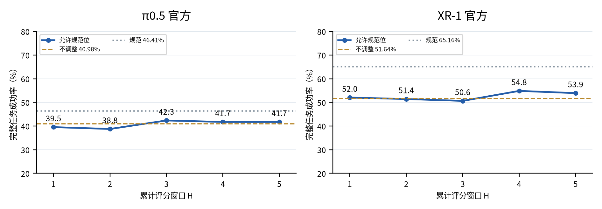
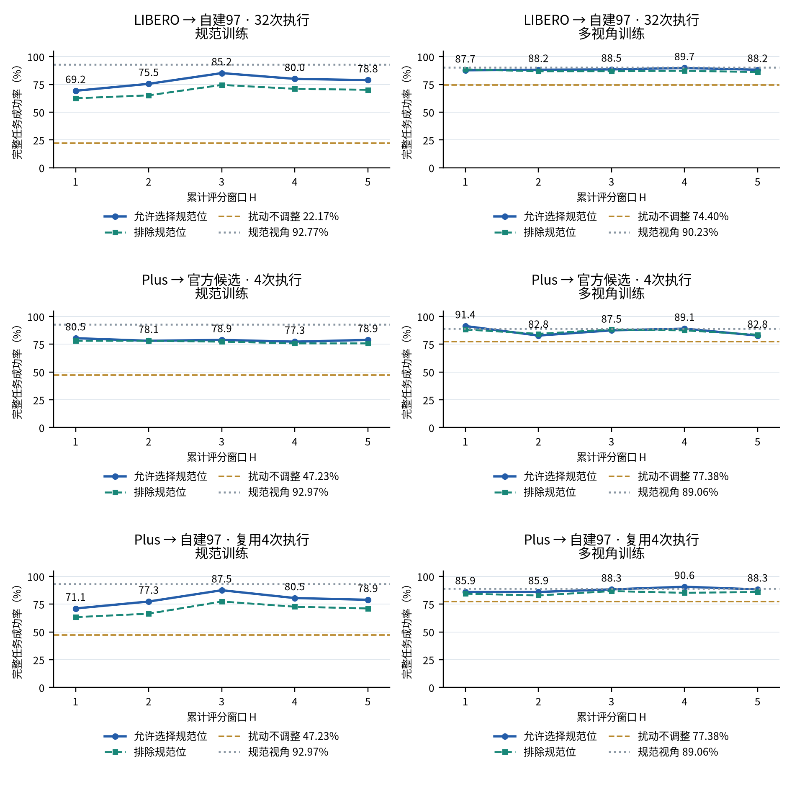
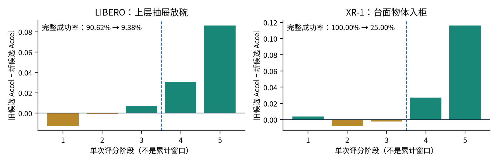

# 科研进展双周报

汇报人：龙君昱　　学号：26B951131

汇报周期：2026年10月1日—10月14日　｜　汇报日期：2026年10月15日

## 一、本期工作：新增模型对照与多步视角诊断

围绕“如何选择视角以恢复模型性能”，本期新增XR-1模型对照，检验更好的模型表现能否带来更有效的Accel选位；同时将初态单次评分扩展为前1–5次重规划评分，完成RoboCasa独立验证及LIBERO、LIBERO-Plus对照。沿用已有权重，不重新训练模型。

| 实验 | 完成内容 |
|---|---|
| RoboCasa 独立确认 | 官方π0.5、XR-1各80个新初态／10个已知任务；97候选×8评分噪声。冻结各窗口终点后，用8套独立执行噪声确认；去重完成44,376次完整任务。 |
| LIBERO / Plus补充 | 同8任务×4初态、规范／多视角两模型。LIBERO复用每候选原32次闭环成绩；Plus完成10,912次官方相机扰动闭环，每格4次，另完成五窗口评分。 |

方法：各候选从同一初态短暂试执行，以前H次重规划的累计Accel选位，再复位执行完整任务。W1为初态评分，评分与执行噪声分离。正式执行中不切换候选；RoboCasa相机仍随底盘运动。

## 二、RoboCasa：规范成绩提高，选位收益仍不稳定

图1　每模型80个新初态，seen／heldout各40个，划分布局与风格而非任务。蓝线为窗口1–5选位，橙线为扰动不调整，灰线为规范视角；完整任务评测使用8套新执行噪声。

XR-1规范视角成功率为65.16%，高于π0.5的46.41%，但Accel选位未显示稳定收益。π0.5在W3、XR-1在W4/W5的实测均值均高于扰动不调整，说明存在改善迹象，但尚不能确认稳定恢复。

π0.5：W1为39.53%，W3升至42.34%；XR-1：W1为52.03%，W4升至54.84%。多步评分能够改善部分选位，但收益没有随窗口长度稳定累积，需要进一步判断何时采用后续评分。

预先指定的W3相对扰动不调整：π0.5为+1.36 pp，95%区间[-3.89, +6.56]；XR-1为-1.02 pp，95%区间[-9.59, +6.48]。区间均包含零。W4/W5的改善为观察结果，尚不能据此确定通用窗口。

### 待核实：任务与评测设置的影响

RoboCasa当前10个任务在规范视角下仍有较多失败；扰动使π0.5、XR-1分别下降5.42、13.52个百分点。恢复收益可能受任务能力、视角敏感性及相机设置影响。两环境的模型、输入与执行方式也不同，尚不能认定差异由benchmark本身造成；规范与扰动的差距也不是视角恢复的上限。

## 三、LIBERO与Plus：多步有效，但依赖候选空间

图2　三排均为同8任务、32初态。第三排以Plus扰动为不调整基线，复用LIBERO同初态的97候选评分及前4次闭环成绩，不能算作另一份独立验证；未评测从扰动位实际移动到目标位的过程。

规范模型W1→W3：LIBERO为69.24%→85.16%；Plus→自建97为71.09%→87.50%，排除规范位后仍分别提高12.01、14.06个百分点。Plus官方候选中未见稳定的额外收益，多视角模型的增益也较小。多步诊断有作用，但更长不一定更好。

扰动基线不同：匹配4次执行时，自建扰动／Plus扰动的成功率，规范模型为22.95%／47.23%，多视角模型为75.29%／77.38%。多步收益需结合候选范围和训练条件判断，不能笼统概括为“Plus上无效”。

## 四、为什么窗口加长后反而下降？

| 条件 | W1→W3：改善/退化/相等 | W3→W5：改善/退化/相等 |
|---|---|---|
| LIBERO规范 | 10 / 0 / 22（+15.92 pp） | 1 / 6 / 25（-6.35 pp） |
| RoboCasa π0.5 | 21 / 15 / 44（+2.81 pp） | 12 / 17 / 51（-0.63 pp） |
| RoboCasa XR-1 | 10 / 13 / 57（-1.41 pp） | 14 / 7 / 59（+3.28 pp） |

表1　按初态比较所选视角的完整任务成功率，允许选择规范位。LIBERO每候选32次执行、RoboCasa8次；数量表示实测改善或退化，不代表逐初态显著性检验。

LIBERO规范模型的改善覆盖6类任务；W3→W5的净下降约82%来自“上层抽屉放碗”。RoboCasa中改善与退化并存，XR-1在W3之后回升，当前结果不支持统一采用某个窗口。

图3　正柱表示新候选Accel更低。后两阶段评分使方法改选较差视角：LIBERO成功次数29/32→3/32，XR-1为8/8→2/8。两例的8套评分噪声均偏向较差候选，前后两半执行结果也均退化，提示问题不只是评分波动。

已确认：累加后续评分有时会改选低成功率视角，评分一致并不保证选择正确。后续评分来自各候选执行后的不同状态，不是对初态的重复测量。待验证：这种误选是否与停滞、遮挡或任务进度差异有关。

窗口时刻并不跨本体对齐：LIBERO／Plus为0、5、10、15、20动作步；RoboCasa π0.5为0、25、50、75、100；XR-1为0、16、32、48、64。H是重规划次数，不是相同物理时长或任务进度。

## 五、下一步工作

① 分析适用条件：沿用预定的任务能力与视角敏感性分组，比较恢复收益；结合已有轨迹核查任务进度、动作推进与评分翻转的关系。
② 改进选位规则：据此研究何时保留早期选择、何时采用后续评分，与W1及固定窗口公平比较；规则冻结后再独立验证。
③ 验证实际执行：选位规则稳定后，研究少量查询下的相机搜索，再开展头部主动相机验证。当前候选试执行与复位仍是分析实验，不是可直接部署的方法。

### 实验质量与工程保障

完成三机并行评测与结果去重；修复LIBERO重复复位造成的场景位置漂移，核验首帧及W1一致性。结果、源码与分析记录已归档共享盘。
